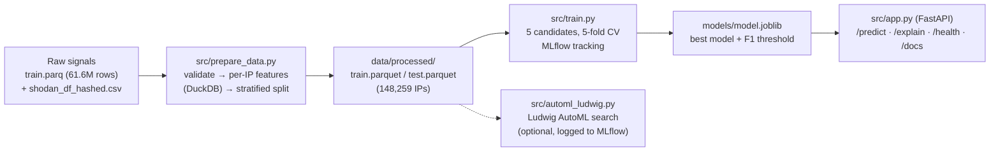

# VPN/Proxy IP Classifier

Predicts whether an attacker IP seen by CrowdSec is a VPN or proxy, from how that IP behaves across its attack signals. Served through a FastAPI endpoint.

**Task:** binary classification, one prediction per attacker IP.
**Metric:** F1 of the VPN/proxy class on a held-out test set of IPs. Only 1.95% of IPs are VPN/proxy, so accuracy is misleading: even the weakest model scores 98.4%.

## Architecture



## Quick start

Requires [uv](https://docs.astral.sh/uv/) and `make`. uv downloads Python 3.11 if needed.

```bash
git clone https://github.com/uzair-khiiba/VPN-Classifier-MLOps.git
cd VPN-Classifier-MLOps
make setup        # .venv with Python 3.11 and pinned dependencies
make serve        # API on http://127.0.0.1:8000, interactive docs at /docs
```

The trained model (`models/model.joblib`, ~300 KB) is committed, so the API runs straight after cloning.

To rebuild the model from scratch:

```bash
# Full data (see "Dataset" for the download): ~3 min prep + ~11 min training on 4 CPU cores
make data         # validate data/raw/train.parq, build per-IP features, split
make train        # train 5 candidates, log them to MLflow, save the best
make mlflow       # MLflow UI on http://127.0.0.1:5000

# Or, without the dataset: the same pipeline on the committed synthetic sample
make data SAMPLE=1 && make train
```

Note that `make train` replaces `models/model.joblib`. After a run on the sample, `git checkout models/` restores the committed model, which was trained on the real data.

Without `make`, the same steps are `python -m src.prepare_data`, `python -m src.train` and `uvicorn src.app:app`.

## Dataset

[CrowdSec](https://www.crowdsec.net/) community data from the Kaggle VPN/proxy classification competition (Oct–Dec 2023).

| File | Contents |
|---|---|
| `train.parq` | 61,629,685 attack signals from 148,259 attacker IPs over one month (Jul 30 – Aug 29, 2023): attack time and type, attacker/watcher country and autonomous system, anonymised IP and watcher IDs, and `label` (1 = VPN/proxy) |
| `shodan_df_hashed.csv` | Shodan metadata per IP: open ports and hashed TLS/HTTP fingerprints (JARM, JA3S, header hash) |

Download both from Kaggle and place them in `data/raw/`. They are not committed: `train.parq` is 700 MB. Kaggle's `test.parq` has no labels and isn't used. Our test set is a held-out 20% of the labelled IPs.

`data/sample/` holds a small **synthetic** dataset with the same schema, used by CI and for trying the pipeline without the download.

## How it works

**Unit of prediction.** The label belongs to the IP, but the data has one row per attack signal. `src/features.py` collapses each IP into one row of 28 behavioural features with DuckDB, which streams the 61.6M rows using about 6 GB of RAM:

- **Volume and timing:** signal count, active hours and days, signals per day, busiest hour, gaps between signals.
- **Breadth:** distinct attack types, watchers, watcher ASNs and countries, attacker ASNs.
- **Mix:** share of each of the 8 common attack types.
- **ASN crowding:** how many attacker IPs share this IP's ASN.
- **Shodan:** TCP and UDP port counts, and how many other IPs share this IP's JARM, JA3S or HTTP-header fingerprints.

The anonymised IP ID is never a model input.

**Leakage.** There is one row per IP, so the stratified 80/20 split cannot put the same IP in both train and test, and `split_by_ip` asserts this. Model and threshold selection use only 5-fold cross-validation on the training set; the test set is scored once per run, for reporting.

**Validation** (`src/prepare_data.py`). It checks that:
- the required columns exist
- the ID, time, type and label columns have no nulls
- labels are only 0 or 1, and each IP has a single label
- the attack-time range is valid
- the feature table has one row per IP, no NaNs and no negative values

It fails loudly otherwise.

**Imbalance.** All models use balanced class weights. Each model's probability threshold is then tuned to maximise F1 on its out-of-fold predictions. The defaults would be 0.5; the tuned thresholds are shown below.

## Experiments (MLflow)

**Live run history:** [DagsHub MLflow, `vpn-proxy-classification`](https://dagshub.com/uzair-khiiba/VPN-Classifier-MLOps.mlflow/#/experiments/0). It is a hosted MLflow server connected to this repo, so the runs can be browsed without installing anything. Locally, runs go to `mlflow.db` (`make mlflow` opens the UI).

To log to DagsHub instead of the local database, set these before `make train`. Never commit the token.

```bash
export MLFLOW_TRACKING_URI=https://dagshub.com/uzair-khiiba/VPN-Classifier-MLOps.mlflow
export MLFLOW_TRACKING_USERNAME=<dagshub username>
export MLFLOW_TRACKING_PASSWORD=<dagshub access token>
```

`make train` logs one MLflow run per candidate to experiment `vpn-proxy-classification`, with parameters, cross-validated F1, the tuned threshold and test metrics (F1, precision, recall, PR-AUC, ROC-AUC, accuracy). The best run is tagged `best_model=true`.

Results on the full data (118,607 train IPs, 29,652 test IPs):

| Run | Model | CV F1 | **Test F1** | Precision | Recall | PR-AUC | Threshold |
|---|---|---|---|---|---|---|---|
| `hgb_slow` ✅ | HistGradientBoosting, lr 0.05, 600 iters, 63 leaves, L2 1.0 | **0.769** | **0.766** | 0.733 | 0.803 | 0.797 | 0.90 |
| `hgb` | HistGradientBoosting, lr 0.1, 300 iters | 0.766 | 0.761 | 0.732 | 0.792 | 0.781 | 0.91 |
| `rf` | RandomForest, 200 trees, unlimited depth | 0.761 | 0.750 | 0.708 | 0.798 | 0.804 | 0.34 |
| `rf_shallow` | RandomForest, 300 trees, depth 12 | 0.729 | 0.709 | 0.704 | 0.713 | 0.729 | 0.83 |
| `logreg` | Logistic regression on log1p + standardised features | 0.594 | 0.597 | 0.574 | 0.621 | 0.551 | 0.94 |
| `ludwig_automl` | Ludwig neural net, best of 20 AutoML trials (2 × 128 layers, dropout 0.18, lr 0.0066) | 0.723* | 0.711 | 0.706 | 0.716 | 0.739 | 0.35 |

**Chosen model: `hgb_slow`.** It has the highest cross-validated F1, which is the selection rule. We picked it without looking at the test scores, and it also has the best test F1. It catches 80% of VPN/proxy IPs, and 73% of the IPs it flags really are VPN/proxy. The model file is 294 KB and predicts in milliseconds.

- **Logistic regression** trails by about 17 F1 points. The signal is non-linear: being in Shodan matters mostly together with shared fingerprints and a slow, spread-out attack pattern.
- **`rf`** has a slightly higher PR-AUC but lower F1 at its best threshold.
- **Ludwig AutoML** (\* F1 on a single validation split, not 5-fold CV) lands between the two random forests. Its 20-trial search maximised validation ROC-AUC (0.988), which ignores the decision threshold. The best trial therefore used no extra weight on the positive class, and the F1 threshold was tuned afterwards. Gradient-boosted trees remain the better choice for this tabular data, and they are much smaller and faster to serve.

## API

| Endpoint | Description |
|---|---|
| `GET /health` | Status, and whether the model is loaded, with its name and version |
| `POST /predict` | The 28 features of one IP → `is_vpn_proxy`, `probability`, the threshold and the model version |
| `POST /explain?top_k=8` | The prediction, plus each feature's effect: how much the probability changes when that feature is replaced by its training median |
| `GET /docs` | Auto-generated Swagger UI, with the two example IPs below preloaded |

Pydantic validates every field: counts must be ≥ 0 (or ≥ 1 where an IP always has one), shares and flags must be in [0, 1], all fields are required, and unknown fields are rejected. If no model is loaded, `/health` reports `degraded` and `/predict` returns 503.

```bash
curl -X POST http://127.0.0.1:8000/predict -H "Content-Type: application/json" -d @examples/vpn_ip.json
# {"is_vpn_proxy":true,"probability":0.9923,"threshold":0.9015,"model_version":"hgb_slow-20261019-173911"}

curl -X POST http://127.0.0.1:8000/predict -H "Content-Type: application/json" -d @examples/regular_ip.json
# {"is_vpn_proxy":false,"probability":0.0055,"threshold":0.9015,"model_version":"hgb_slow-20261019-173911"}

curl -X POST "http://127.0.0.1:8000/explain?top_k=3" -H "Content-Type: application/json" -d @examples/vpn_ip.json
# contributions: has_shodan +0.394, headers_hash_shared +0.058, n_tcp_ports +0.054
```

`examples/` contains two typical IPs from the held-out test set: a VPN/proxy IP and a regular one.

## AutoML with Ludwig (optional)

`configs/ludwig_automl.yaml` defines a [Ludwig](https://ludwig.ai/) tabular neural network on the same 28 features, with a hyperparameter search over:
- learning rate and batch size
- number of layers, layer width and dropout
- the positive-class loss weight

The search runs 20 trials with Ray Tune and the TPE algorithm, stops bad trials early (ASHA), and has a 1-hour budget. `src/automl_ludwig.py` runs the search on a train/validation split of the training IPs, retrains the best trial, tunes its F1 threshold on validation, and logs it to the same MLflow experiment as `ludwig_automl`, so it can be compared with the runs above.

```bash
make setup-automl          # separate .venv-ludwig: Ludwig 0.11.0 + PyTorch (CPU) + Ray, ~2 GB
make automl                # full search, ~28 min on 4 CPU cores (TRIALS=4 for a quick one)
```

Ludwig has its own environment because of its size; the API and CI don't need it. 0.11.0 is the last Ludwig release that supports Python 3.11. `src/automl_ludwig.py` disables one Ludwig 0.11 post-search step that crashes when re-evaluating trials ASHA stopped early; the runner retrains and evaluates the best trial itself instead.

## Tests

```bash
make test         # pytest: 39 tests, ~5 s, no dataset needed
make lint         # ruff
```

| File | Covers |
|---|---|
| `tests/test_prepare_data.py` | Validation (missing columns, null IDs, bad or conflicting labels, time-zone-aware timestamps), hand-checked feature values, Shodan parsing and fingerprint sharing, split leakage and stratification, end-to-end `prepare()` |
| `tests/test_model_io.py` | Model bundle save/load round trip; missing, corrupt and invalid files; bad thresholds |
| `tests/test_app.py` | `/health` with and without a model, `/predict` output, 422 on invalid or missing or extra fields, `/explain` ordering, `/docs`, docs examples are valid requests |
| `tests/test_automl_config.py` | Ludwig config matches the pipeline's features; search parameters point at real config sections (no Ludwig install needed) |

CI (`.github/workflows/ci.yml`) runs ruff, then pytest, then the whole pipeline on the synthetic sample, on every push.

## Repository layout

```
src/            config, features, prepare_data, train, model_io, app (FastAPI), automl_ludwig
tests/          pytest suite and synthetic-data fixtures
configs/        Ludwig AutoML config
data/sample/    small synthetic dataset (raw data goes in data/raw/, not committed)
models/         model.joblib (served model) and model_meta.json (its metrics and MLflow run ID)
examples/       example request bodies
```

## Credits

- Feature ideas, including fingerprint sharing, ASN crowding and attack timing, are adapted from the public 2nd-place solution notebook of the CrowdSec Kaggle competition ("crowdsec-vpn-classification-2nd-place"). Our code is a reimplementation, not a copy.
- Libraries: scikit-learn, DuckDB, pandas, PyArrow, MLflow, FastAPI, Pydantic, Uvicorn, pytest, Ruff, and Ludwig, Ray and PyTorch for the optional AutoML.
- See `AI_USAGE.md` for how AI assistants were used.

## License

MIT, see `LICENSE`. Team and contributions: `CONTRIBUTION.md`.
