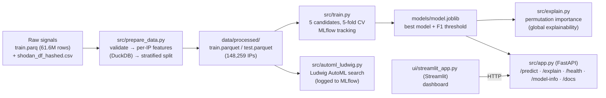
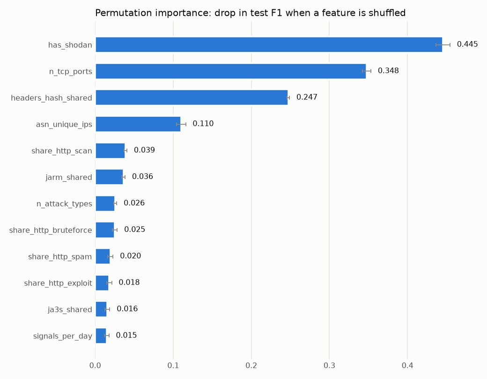

# VPN/Proxy IP Classifier

Predicts whether an attacker IP seen by CrowdSec is a VPN or proxy, from how that IP behaves across its attack signals. Served through a FastAPI endpoint.

**Task:** binary classification, one prediction per attacker IP.
**Metric:** F1 of the VPN/proxy class on a held-out test set of IPs. Only 1.95% of IPs are VPN/proxy, so accuracy is misleading: even the weakest model scores 98.4%.

**Guide:** [docs/MILESTONE1_GUIDE.md](docs/MILESTONE1_GUIDE.md) gives step-by-step run instructions and explains every design decision.

## Architecture



Plain-text version:

```
data/raw/train.parq ─► prepare_data.py ─► data/processed/ ─► train.py ─► models/model.joblib ─► app.py (FastAPI)
  (61.6M signals)      validate + per-IP    (148,259 IPs,     5 models,     (best model +         /predict /explain
                       features + split      80/20 split)     MLflow        F1 threshold)          /health /docs
```

## Quick start

Requires [uv](https://docs.astral.sh/uv/) and `make`. uv downloads Python 3.11 if needed.

```bash
git clone https://github.com/uzair-khiiba/VPN-Classifier-MLOps.git
cd VPN-Classifier-MLOps
make setup        # .venv with Python 3.11 and pinned dependencies
make serve        # API on http://127.0.0.1:8000, interactive docs at /docs
```

The trained model (`models/model.joblib`, ~300 KB) is committed, so the API runs straight after cloning.

To rebuild the model from scratch:

```bash
# Full data (see "Dataset" for the download): ~3 min prep + ~11 min training on 4 CPU cores
make data         # validate data/raw/train.parq, build per-IP features, split
make train        # train 5 candidates, log them to MLflow, save the best
make explain      # global explainability: permutation importance on the test set (~30 s)
make mlflow       # MLflow UI on http://127.0.0.1:5000

# Or, without the dataset: the same pipeline on the committed synthetic sample
make data SAMPLE=1 && make train SAMPLE=1
```

With `SAMPLE=1`, the outputs go to `data/processed-sample/` and `models/sample/`, so the committed model trained on the real data is never overwritten. MLflow logs these runs to a separate experiment, `vpn-proxy-classification-sample`.

Without `make`, the same steps are `python -m src.prepare_data`, `python -m src.train` and `uvicorn src.app:app`.

## Dashboard

A Streamlit dashboard, **Explainable VPN & Proxy Detector**, lets you enter an IP's features, get a prediction, see why the model made it, review evaluation results and check the API's status. It reaches the model only through HTTP calls to the API. The full walkthrough is in [docs/UI_AND_API_GUIDE.md](docs/UI_AND_API_GUIDE.md).

On Windows, in Command Prompt from the project folder:

```bat
:: First time only
.venv\Scripts\python -m pip install -r requirements-ui.txt

:: Terminal 1: the API
.venv\Scripts\python -m uvicorn src.app:app --host 127.0.0.1 --port 8000

:: Terminal 2: the dashboard, at http://localhost:8501
.venv\Scripts\python -m streamlit run ui/streamlit_app.py
```

On Linux or macOS, `make setup-ui`, then `make serve` and `make ui` in two terminals.

Set `API_BASE_URL` if the API runs elsewhere. The default is `http://127.0.0.1:8000`, and `.env.example` shows the file option.

**The IP Detection page scores an IP three ways:**

1. **Look up an IP ID.** Enter the ID of an IP from the held-out test set. The API fetches its stored features and shows the true class next to the prediction.
2. **From attack events.** For a new IP, enter its CrowdSec signals (one row each, typed or uploaded as CSV) and its Shodan ports. The API computes the 28 features exactly as the training pipeline does.
3. **Enter all 28 features** directly, with two real held-out test records as labelled demos.

The dataset anonymises IPs, so an "IP" here is its ID (`attacker_ip_enum`), not an address like 1.2.3.4. The API serves `hgb_slow`. The experimental 400-tree model appears only as a labelled comparison.

## Dataset

[CrowdSec](https://www.crowdsec.net/) community data from the Kaggle VPN/proxy classification competition (Oct–Dec 2023).

| File | Contents |
|---|---|
| `train.parq` | 61,629,685 attack signals from 148,259 attacker IPs over one month (Jul 30 – Aug 29, 2023): attack time and type, attacker/watcher country and autonomous system, anonymised IP and watcher IDs, and `label` (1 = VPN/proxy) |
| `shodan_df_hashed.csv` | Shodan metadata per IP: open ports and hashed TLS/HTTP fingerprints (JARM, JA3S, header hash) |

Download both from Kaggle and place them in `data/raw/`. They are not committed: `train.parq` is 700 MB. Kaggle's `test.parq` has no labels and isn't used. Our test set is a held-out 20% of the labelled IPs.

`data/sample/` holds a small **synthetic** dataset with the same schema, for trying the pipeline without the download.

## How it works

**Unit of prediction.** The label belongs to the IP, but the data has one row per attack signal. `src/features.py` collapses each IP into one row of 28 behavioural features with DuckDB, which streams the 61.6M rows using about 6 GB of RAM:

- **Volume and timing:** signal count, active hours and days, signals per day, busiest hour, gaps between signals.
- **Breadth:** distinct attack types, watchers, watcher ASNs and countries, attacker ASNs.
- **Mix:** share of each of the 8 common attack types.
- **ASN crowding:** how many attacker IPs share this IP's ASN.
- **Shodan:** TCP and UDP port counts, and how many other IPs share this IP's JARM, JA3S or HTTP-header fingerprints.

The anonymised IP ID is never a model input.

**Leakage.** There is one row per IP, so the stratified 80/20 split cannot put the same IP in both train and test, and `split_by_ip` asserts this. Model and threshold selection use only 5-fold cross-validation on the training set; the test set is scored once per run, for reporting.

**Validation** (`src/prepare_data.py`). It checks that:
- the required columns exist
- the ID, time, type and label columns have no nulls
- labels are only 0 or 1, and each IP has a single label
- the attack-time range is valid
- the feature table has one row per IP, no NaNs and no negative values

It fails loudly otherwise.

**Imbalance.** All models use balanced class weights. Each model's probability threshold is then tuned to maximise F1 on its out-of-fold predictions. The defaults would be 0.5; the tuned thresholds are shown below.

## Experiments (MLflow)

Runs are tracked locally in `mlflow.db`. `make mlflow` opens the MLflow UI on http://127.0.0.1:5000.

`make train` logs one MLflow run per candidate to experiment `vpn-proxy-classification`, with parameters, cross-validated F1, the tuned threshold and test metrics (F1, precision, recall, PR-AUC, ROC-AUC, accuracy). The best run is tagged `best_model=true`.

Results on the full data (118,607 train IPs, 29,652 test IPs):

| Run | Model | CV F1 | **Test F1** | Precision | Recall | PR-AUC | Threshold |
|---|---|---|---|---|---|---|---|
| `hgb_slow` ✅ | HistGradientBoosting, lr 0.05, 600 iters, 63 leaves, L2 1.0 | **0.769** | **0.766** | 0.733 | 0.803 | 0.797 | 0.90 |
| `hgb` | HistGradientBoosting, lr 0.1, 300 iters | 0.766 | 0.761 | 0.732 | 0.792 | 0.781 | 0.91 |
| `rf` | RandomForest, 200 trees, unlimited depth | 0.761 | 0.750 | 0.708 | 0.798 | 0.804 | 0.34 |
| `rf_shallow` | RandomForest, 300 trees, depth 12 | 0.729 | 0.709 | 0.704 | 0.713 | 0.729 | 0.83 |
| `logreg` | Logistic regression on log1p + standardised features | 0.594 | 0.597 | 0.574 | 0.621 | 0.551 | 0.94 |
| `ludwig_automl` | Ludwig neural net, best of 20 AutoML trials (2 × 128 layers, dropout 0.18, lr 0.0066) | 0.723* | 0.711 | 0.706 | 0.716 | 0.739 | 0.35 |

**Chosen model: `hgb_slow`.** It has the highest cross-validated F1, which is the selection rule. We picked it without looking at the test scores, and it also has the best test F1. It catches 80% of VPN/proxy IPs, and 73% of the IPs it flags really are VPN/proxy. The model file is 294 KB and predicts in milliseconds.

- **Logistic regression** trails by about 17 F1 points. The signal is non-linear: being in Shodan matters mostly together with shared fingerprints and a slow, spread-out attack pattern.
- **`rf`** has a slightly higher PR-AUC but lower F1 at its best threshold.
- **Ludwig AutoML** (\* F1 on a single validation split, not 5-fold CV) lands between the two random forests. Its 20-trial search maximised validation ROC-AUC (0.988), which ignores the decision threshold. The best trial therefore used no extra weight on the positive class, and the F1 threshold was tuned afterwards. Gradient-boosted trees remain the better choice for this tabular data, and they are much smaller and faster to serve.

## API

| Endpoint | Description |
|---|---|
| `GET /health` | Status, and whether the model is loaded, with its name and version |
| `GET /model-info` | The served model's identity and saved evaluation metrics |
| `POST /predict` | The 28 features of one IP → `prediction`, `label`, `is_vpn_proxy`, `probability`, the threshold and the model version |
| `GET /predict/ip/{ip_id}` | An IP from the held-out test set, by ID → the prediction, its stored features and its true class (404 if it isn't in the test set) |
| `GET /ips/{ip_id}` | The stored features and true class of a test-set IP, without scoring |
| `POST /predict/signals` | A new IP's raw signals and Shodan ports → the prediction and the 28 features computed from them |
| `POST /features/from-signals` | The 28 features computed from raw signals, without scoring |
| `POST /explain?top_k=8` | The prediction, plus each feature's effect: how much the probability changes when that feature is replaced by its training median |
| `GET /docs` | Auto-generated Swagger UI, with the two example IPs below preloaded |

Pydantic validates every field: counts must be whole numbers ≥ 0 (or ≥ 1 where an IP always has one), shares must be in [0, 1], flags must be 0 or 1, all fields are required, and unknown fields are rejected. Combinations the pipeline can't produce are rejected too, such as open ports with `has_shodan = 0` or attack shares adding up to more than 1 (the full list is in [docs/UI_AND_API_GUIDE.md](docs/UI_AND_API_GUIDE.md)). A model file with a non-numeric threshold, missing metadata, or features that differ from the API's 28 is treated as no model. If no model is loaded, `/health` reports `degraded` and the model endpoints return 503. The reason goes to the server log, so clients never see file paths. `/explain` also reports whether resetting each feature would flip the class.

**Scoring from an IP ID or from raw signals.** Two committed files, built by `make lookup` (`python -m src.online_features`), make this work in a fresh clone without the dataset:

- `models/ip_lookup.parquet`: the 29,652 held-out test IPs, with their features and true class.
- `models/feature_reference.json`: how many IPs each network (ASN) holds and how many IPs share each Shodan fingerprint, over the full data. `asn_unique_ips` and the three `*_shared` features compare an IP with every other IP, so a single IP's signals can't produce them; the API looks them up here.

For a new IP the computed features are exactly what the training pipeline would produce: `tests/test_online_features.py` checks this on synthetic data, and it matched on 500 real test IPs rebuilt from the raw signals. If either file is missing, only the endpoints that need it return 503, and `/health` reports `ip_lookup_loaded` and `feature_reference_loaded`.

```bash
curl http://127.0.0.1:8000/predict/ip/47584
curl -X POST http://127.0.0.1:8000/predict/signals -H "Content-Type: application/json" -d @examples/signals_request.json
curl -X POST http://127.0.0.1:8000/predict -H "Content-Type: application/json" -d @examples/vpn_ip.json
# {"prediction":1,"label":"VPN/Proxy","is_vpn_proxy":true,"probability":0.9923,"threshold":0.9015,"model_version":"hgb_slow-20261019-173911"}

curl -X POST http://127.0.0.1:8000/predict -H "Content-Type: application/json" -d @examples/regular_ip.json
# {"prediction":0,"label":"Not VPN/Proxy","is_vpn_proxy":false,"probability":0.0055,"threshold":0.9015,"model_version":"hgb_slow-20261019-173911"}

curl -X POST "http://127.0.0.1:8000/explain?top_k=3" -H "Content-Type: application/json" -d @examples/vpn_ip.json
# contributions: has_shodan +0.394, headers_hash_shared +0.058, n_tcp_ports +0.054
```

`examples/` contains two typical IPs from the held-out test set: a VPN/proxy IP and a regular one.

## Explainability

The model is explained at two levels.

**Global: which features the model relies on.** `make explain` runs `src/explain.py`, which computes permutation importance on the 29,652 held-out test IPs. It shuffles one feature at a time, which breaks that feature's link to the label, and measures how much test F1 drops at the model's own threshold. Each feature is shuffled 5 times. The results are in `models/feature_importance.json` and the chart below.



| Rank | Feature | Test F1 drop when shuffled |
|---|---|---|
| 1 | `has_shodan` | 0.445 |
| 2 | `n_tcp_ports` | 0.348 |
| 3 | `headers_hash_shared` | 0.247 |
| 4 | `asn_unique_ips` | 0.110 |
| 5 | `share_http_scan` | 0.039 |

The Shodan view of an IP dominates: whether Shodan saw it at all, how many TCP ports are open, and how many other IPs share its HTTP header fingerprint. VPN and proxy servers run the same software on the same ports, so they share fingerprints. ASN crowding comes next, since hosting and VPN networks contain many attacker IPs. The attack-timing features add comparatively little once those are known.

**Local: why this IP got this prediction.** `POST /explain` replaces one feature at a time with its training median, re-predicts, and reports how much the probability changes. For the VPN example, `has_shodan=1` adds +0.39 and `headers_hash_shared=690` adds +0.06. Both methods are model-agnostic, so they work unchanged for any model the pipeline selects.

## AutoML with Ludwig

`configs/ludwig_automl.yaml` defines a [Ludwig](https://ludwig.ai/) tabular neural network on the same 28 features, with a hyperparameter search over:
- learning rate and batch size
- number of layers, layer width and dropout
- the positive-class loss weight

The search runs 20 trials with Ray Tune and the TPE algorithm, stops bad trials early (ASHA), and has a 1-hour budget. `src/automl_ludwig.py` runs the search on a train/validation split of the training IPs, retrains the best trial, tunes its F1 threshold on validation, and logs it to the same MLflow experiment as `ludwig_automl`, so it can be compared with the runs above.

```bash
make setup-automl          # separate .venv-ludwig: Ludwig 0.11.0 + PyTorch (CPU) + Ray, ~2 GB
make automl                # full search, ~28 min on 4 CPU cores (TRIALS=4 for a quick one)
```

Ludwig has its own environment because of its size; the API doesn't need it. 0.11.0 is the last Ludwig release that supports Python 3.11. `src/automl_ludwig.py` disables one Ludwig 0.11 post-search step that crashes when re-evaluating trials ASHA stopped early; the runner retrains and evaluates the best trial itself instead.

## Tests

```bash
make test         # pytest: 90 tests, about 90 s, no dataset needed
make lint         # ruff
```

| File | Covers |
|---|---|
| `tests/test_prepare_data.py` | Validation (missing columns, null IDs, bad or conflicting labels, time-zone-aware timestamps), hand-checked feature values, Shodan parsing and fingerprint sharing, split leakage and stratification, end-to-end `prepare()` |
| `tests/test_model_io.py` | Model bundle save/load round trip; missing, corrupt and invalid files; bad thresholds; the committed `models/model.joblib` loads and classifies both example IPs correctly |
| `tests/test_app.py` | `/health` with and without a model, `/predict` output, 422 on invalid or missing or extra fields, `/explain` ordering, `/docs`, docs examples are valid requests |
| `tests/test_api_extended.py` | Labels, `/model-info`, no file paths in errors, infinite values rejected, one model load, API documentation |
| `tests/test_ui_client.py` | The dashboard's HTTP client against the real API, backend down, invalid responses, and that `ui/` never imports the model |
| `tests/test_ui_app.py` | Every dashboard page run headlessly, including offline and no-model behaviour |
| `tests/test_explain.py` | Permutation importance ranks the one informative feature first; the F1 scorer respects the threshold; the chart is written |
| `tests/test_automl_config.py` | Ludwig config matches the pipeline's features; search parameters point at real config sections (no Ludwig install needed) |

## Repository layout

```
src/            config, features, online_features (lookup data, features for one IP), prepare_data, train, model_io, app (FastAPI), explain, automl_ludwig
ui/             Streamlit dashboard: streamlit_app, api_client (HTTP), features, reports, views/
tests/          pytest suite and synthetic-data fixtures
configs/        Ludwig AutoML config
data/sample/    small synthetic dataset (raw data goes in data/raw/, not committed)
models/         model.joblib (served model), model_meta.json (its metrics and MLflow run ID), feature_importance.json, ip_lookup.parquet + feature_reference.json (API lookup data)
examples/       example request bodies (28 features, and raw signals)
```

## Credits

- Feature ideas, including fingerprint sharing, ASN crowding and attack timing, are adapted from the public 2nd-place solution notebook of the CrowdSec Kaggle competition ("crowdsec-vpn-classification-2nd-place"). Our code is a reimplementation, not a copy.
- Libraries: scikit-learn, DuckDB, pandas, PyArrow, MLflow, FastAPI, Pydantic, Uvicorn, pytest, Ruff, Streamlit and Altair for the dashboard, and Ludwig, Ray and PyTorch for the optional AutoML.
- See `AI_USAGE.md` for how AI assistants were used.

## License

MIT, see `LICENSE`. Team and contributions: `CONTRIBUTION.md`.
