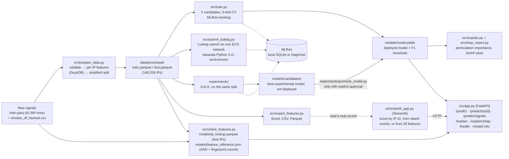
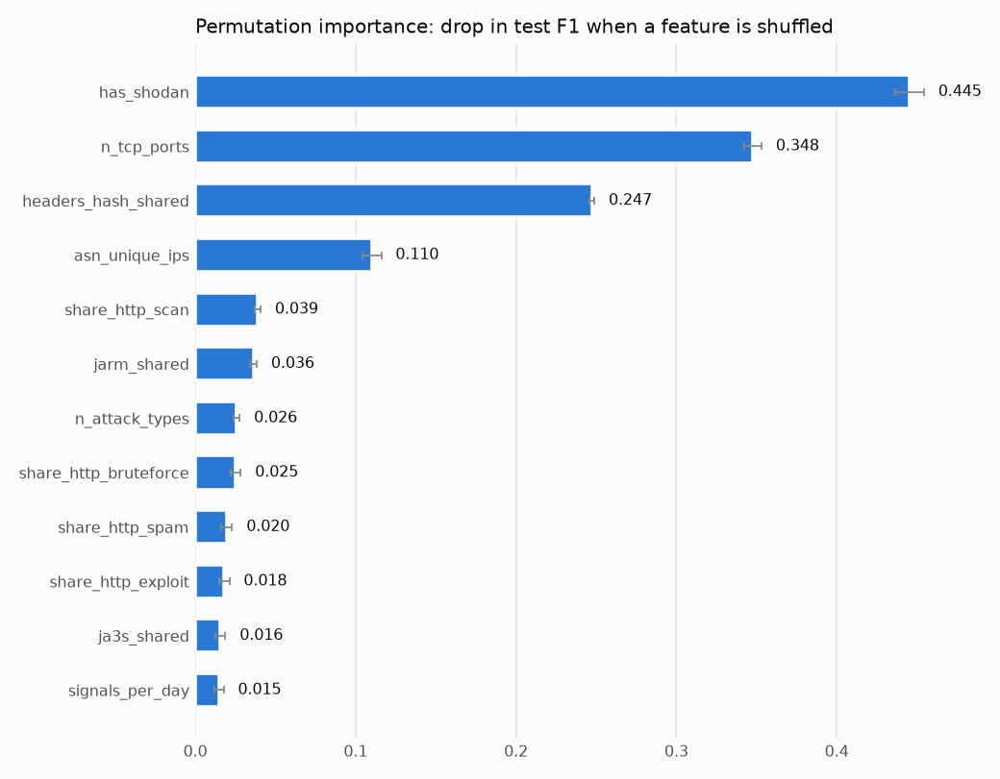
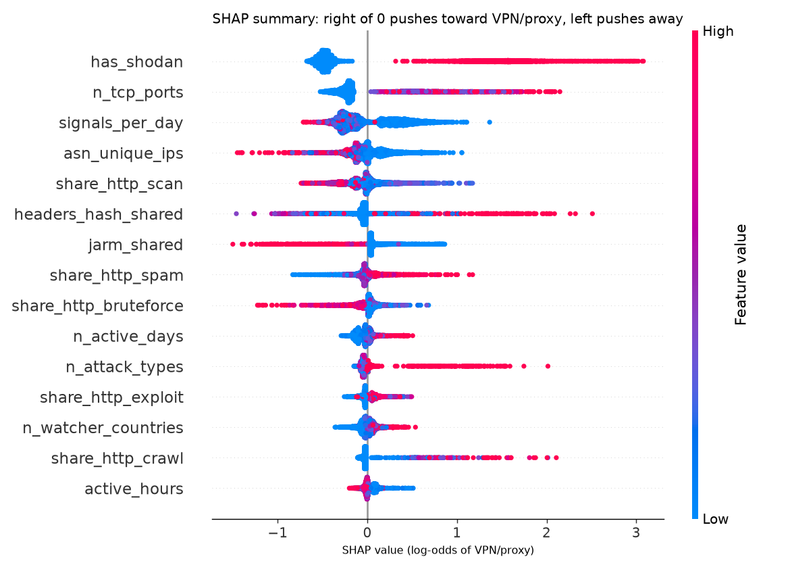

# VPN/Proxy IP Classifier

[](https://github.com/uzair-khiiba/VPN-Classifier-MLOps/actions/workflows/ci.yml)

Predicts whether an attacker IP seen by CrowdSec is a VPN or proxy, from how that IP behaves across its attack signals. Served through a FastAPI endpoint, packaged with Docker and deployed on Render.

**Live API:** <https://vpn-proxy-api.onrender.com> · [interactive docs](https://vpn-proxy-api.onrender.com/docs) · [health](https://vpn-proxy-api.onrender.com/health) · [monitoring](https://vpn-proxy-api.onrender.com/stats) (`/stats`, also at `/metrics`). It runs on Render's free plan, so the first request after 15 idle minutes takes 30–60 s. If the link doesn't answer, the service was shut down after grading to save cost; [Deployment](#deployment-milestone-2) shows how to bring it back.

**Live dashboard:** <https://vpn-proxy-dashboard.onrender.com>, which calls the live API above. See [Dashboard](#dashboard).

**Project focus:** AutoML versus manual training. See [Project Focus](#project-focus-automl-vs-manual-training).

**The problem.** CrowdSec reports attacks, not who is behind them. Telling a VPN or proxy exit from a directly attacking machine matters when deciding whether to block an address, since a VPN IP is shared by many users. The model makes that call for one IP from its aggregated behaviour and its Shodan footprint.

## Milestone 2 at a glance

| Requirement | Where | Status |
|---|---|---|
| Dockerfile with `/health` healthcheck | [Dockerfile](Dockerfile), [.dockerignore](.dockerignore) | Built and run locally; reports `(healthy)` |
| CI: lint, test, Docker build | [.github/workflows/ci.yml](.github/workflows/ci.yml) | Runs on every push; builds and smoke-tests the image |
| Deployment | Render web services, [render.yaml](render.yaml) | API live at <https://vpn-proxy-api.onrender.com>; dashboard at <https://vpn-proxy-dashboard.onrender.com> |
| Monitoring | `GET /stats` (alias `GET /metrics`), per-request logs | Request count, errors and average latency per endpoint |
| Redeploy and rollback | [RUNBOOK.md](RUNBOOK.md) | By image tag `sha-<commit>` |
| Project Focus | [below](#project-focus-automl-vs-manual-training) | FLAML and the full Ludwig v2 search are done (below); the hands-off budget runs and the final report are future work |
| Contributions | [CONTRIBUTION.md](CONTRIBUTION.md) | Names, ERP IDs and the Milestone 2 task table |

## Technologies

| Area | Tools |
|---|---|
| Data and features | DuckDB, pandas, PyArrow |
| Models | scikit-learn (HistGradientBoosting, random forest, logistic regression); Ludwig, Ray Tune and PyTorch for AutoML |
| Experiment tracking | MLflow, with DagsHub as the hosted server |
| Explainability | SHAP, permutation importance |
| Serving | FastAPI, Pydantic, Uvicorn |
| Dashboard | Streamlit, Altair |
| Containers and CI/CD | Docker, GitHub Actions, GitHub Container Registry, Render |
| Quality | pytest, Ruff |

**Task:** binary classification, one prediction per attacker IP.
**Metric:** F1 of the VPN/proxy class on a held-out test set of IPs. Only 1.95% of IPs are VPN/proxy, so accuracy is misleading: even the weakest model scores 98.4%.

**Guides:** [docs/OPERATIONS_GUIDE.md](docs/OPERATIONS_GUIDE.md) has the Windows commands for everything below. [docs/MILESTONE1_GUIDE.md](docs/MILESTONE1_GUIDE.md) explains the design decisions.

## Architecture



MLflow only records results. It doesn't choose or serve models: the API loads `models/model.joblib` directly.

Plain-text version:

```
data/raw/train.parq ─► prepare_data.py ─► data/processed/ ─► train.py ─► models/model.joblib ─► app.py (FastAPI)
  (61.6M signals)      validate + per-IP    (148,259 IPs,     5 models,     (best model +         /predict /explain
                       features + split      80/20 split)     MLflow        F1 threshold)          /predict/ip /predict/signals
                                                  │                                                ▲  /explain/shap /health /docs
                                                  └─► online_features.py ─► models/ip_lookup.parquet ┘
                                                      (lookup data)         models/feature_reference.json
```

## Quick start

**On Windows, use [the Command Prompt instructions](docs/OPERATIONS_GUIDE.md).** `make` and the commands below are for Linux or macOS, and need [uv](https://docs.astral.sh/uv/).

```bash
git clone https://github.com/uzair-khiiba/VPN-Classifier-MLOps.git
cd VPN-Classifier-MLOps
make setup        # .venv with Python 3.12 and the pinned dependencies
make run          # prepare the data if needed -> train all models -> log them to MLflow -> run pytest
make mlflow       # see the training runs at http://127.0.0.1:5000
make serve        # serve the deployed model: API on http://127.0.0.1:8000, interactive docs at /docs
```

Run `make` on its own to list every command.

**`make run` is the whole pipeline in one command.** It prepares the data if `data/processed/` doesn't exist yet, then trains the five candidate models with 5-fold cross-validation, scores each on the held-out test set, and logs every run to MLflow (`mlflow.db`) with its parameters and metrics. It saves the best model, versioned (`models/runs/vpn-clf_<model>_<timestamp>.joblib`), then runs the full pytest suite. On the real data it takes about 3 minutes for preparation, 8 to 11 for training on 4 CPU cores, and 2 for the tests. The seeds are fixed, so a rerun reproduces the same scores: the latest run matched the original exactly (CV F1 0.7694, test F1 0.7663).

Training never overwrites the deployed model, `models/model.joblib`; the API keeps serving it. A new model is deployed only through `python -m experiments.promote_model` (see "Changing the deployed model" below). The deployed model and the lookup data (`models/ip_lookup.parquet`, `models/feature_reference.json`) are committed, so `make serve` works straight after cloning, including lookup by IP ID and scoring from attack events.

**Without the dataset,** run the same pipeline on the committed synthetic sample: `make run SAMPLE=1`. Its outputs go to `data/processed-sample/` and `models/sample/`, and its runs to a separate MLflow experiment, `vpn-proxy-classification-sample`.

The steps can also be run one at a time: `make data`, `make train`, `make test`. Other commands: `make lookup` rebuilds the API's lookup data, `make explain` computes permutation importance, and `make mlflow-experiments` opens the experiment track's 89 runs. Without `make`, the same steps are `python -m src.prepare_data`, `python -m src.train`, `python -m pytest` and `uvicorn src.app:app`.

## Deployment (Milestone 2)

To build and run the API container yourself:

```bash
docker build -t vpn-proxy-api .
docker run -d --name vpn-proxy-api -p 8000:8000 vpn-proxy-api
docker ps                                   # STATUS shows (healthy) after about 20 s
curl http://localhost:8000/health
curl -X POST http://localhost:8000/predict -H "Content-Type: application/json" -d @examples/vpn_ip.json
curl http://localhost:8000/stats
docker rm -f vpn-proxy-api                  # stop and remove it
```

```
git push main ─► GitHub Actions CI ─────────────────────────────────────────────────► Render (free web service)
                 lint (ruff) ─┐                                                       runs ghcr.io/…:sha-<commit>
                 test (pytest)┴► build Docker image ─► smoke test ─► push to GHCR ─► deploy hook   health check /health
```

### Docker

[Dockerfile](Dockerfile) is a two-stage build on `python:3.12-slim`. The first stage installs only the API's runtime packages ([requirements-api.txt](requirements-api.txt)): no MLflow, training or test tools. The second stage copies that environment plus `src/`, the trained model and its lookup data (`models/model.joblib`, `model_meta.json`, `ip_lookup.parquet`, `feature_reference.json`), the request examples and the saved SHAP ranking. It then runs uvicorn as a non-root user on port 8000, or on `$PORT` if the platform sets one. A `HEALTHCHECK` calls `/health` every 30 s and marks the container unhealthy unless the model is loaded (`"status": "ok"`). The image's commit is baked in as `GIT_SHA`, and `/health` reports it as `build`.

```bash
make docker-build          # docker build -t vpn-proxy-api:local .
make docker-run            # docker run -p 8000:8000 vpn-proxy-api:local
docker ps                  # STATUS shows (healthy) after ~20 s
make docker-stop
```

Measured locally: compressed image 243 MB, memory use about 230 MB after serving every endpoint, including SHAP.

### CI ([.github/workflows/ci.yml](.github/workflows/ci.yml))

| Job | Runs on | What it does |
|---|---|---|
| **lint** | every push and PR | `ruff check src tests ui experiments` |
| **test** | every push and PR | `pytest` (about 215 tests; synthetic data and the committed model, no dataset or secrets needed). The pass/fail count shows in the job, and the JUnit report is uploaded as an artifact |
| **build** | after lint and test pass | Builds the Docker image, then starts it and checks `/health`, a `/predict` call, `/metrics`, `/stats`, `/model-info` and the Docker `HEALTHCHECK` status. On a push to `main` it also pushes `ghcr.io/uzair-khiiba/vpn-classifier-mlops:sha-<commit>` and `:latest`. A `v*` tag also pushes `:<tag>` |
| **build-dashboard** | after lint and test pass | The same for the dashboard image ([ui.Dockerfile](ui.Dockerfile)): builds, smoke-tests and, on `main`, pushes `vpn-classifier-dashboard` |
| **deploy** | pushes to `main` | Calls Render's deploy hook with that exact `sha-<commit>` image, waits until the live `/health` reports the new build, then checks `/health`, `/predict` and `/stats` on it |
| **deploy-dashboard** | pushes to `main` | Calls the dashboard's deploy hook with that commit's `sha-<commit>` dashboard image |

**A deploy without its secret is reported as skipped, not as a success.** Each deploy job first checks its deploy hook secret. If it's missing, the deploy steps show as skipped, and the run summary names the missing secret. Lint, test and build never need secrets.

### Deploying on Render

The setup is done once and described in [RUNBOOK.md](RUNBOOK.md#one-time-setup):

1. Push to `main` so CI publishes the first image, then make the GHCR package public.
2. In Render, choose New → Blueprint and select this repo. [render.yaml](render.yaml) creates the `vpn-proxy-api` web service from the GHCR image, with health check path `/health`.
3. Add the service's deploy hook as the repo secret `RENDER_DEPLOY_HOOK_URL`, and its URL as the repo variable `SERVICE_URL`.

After that, every merge to `main` is tested, built and deployed automatically. **Redeploying and rolling back to an earlier image tag** are covered step by step in [RUNBOOK.md](RUNBOOK.md). In short:

```bash
# Redeploy: merge to main, or re-run the latest CI run on main. To roll back, deploy an earlier image tag:
curl -X POST "$RENDER_DEPLOY_HOOK_URL&imgURL=ghcr.io%2Fuzair-khiiba%2Fvpn-classifier-mlops%3Asha-183008a"
curl -s https://vpn-proxy-api.onrender.com/health    # "build" shows which commit is live
```

### Example requests against the deployed service

```bash
URL=https://vpn-proxy-api.onrender.com

curl $URL/health
# {"status":"ok","model_loaded":true,"model_status":"loaded","model":"hgb_slow","version":"20261019-173911",
#  "ip_lookup_loaded":true,"n_lookup_ips":29652,"feature_reference_loaded":true,"build":"<commit>"}

curl -X POST $URL/predict -H "Content-Type: application/json" -d @examples/vpn_ip.json
# {"prediction":1,"label":"VPN/Proxy","is_vpn_proxy":true,"probability":0.9923,"threshold":0.9015,"model_version":"hgb_slow-20261019-173911"}

curl -X POST $URL/predict -H "Content-Type: application/json" -d @examples/regular_ip.json
# {"prediction":0,"label":"Not VPN/Proxy","is_vpn_proxy":false,"probability":0.0055,...}

curl $URL/predict/ip/47584                                   # a held-out test IP, by ID
curl -X POST $URL/predict/signals -H "Content-Type: application/json" -d @examples/signals_request.json
curl -X POST "$URL/explain/shap?top_k=3" -H "Content-Type: application/json" -d @examples/vpn_ip.json
curl $URL/model-info                                         # model name, version, type, threshold, features
curl $URL/stats                                              # monitoring, see below (same data as $URL/metrics)
```

## Monitoring

Every request goes through a small middleware ([src/monitoring.py](src/monitoring.py)) that times it and records it under its route template, so `/predict/ip/1` and `/predict/ip/2` count as one endpoint. Paths that match no route, such as bot scans, are grouped as `<unmatched>`. The numbers are visible in three places:

- **`GET /stats`** and **`GET /metrics`** (counter endpoint, the same data under two names): totals since the process started (requests, 5xx errors, average latency), predictions served per class, and per endpoint the count, errors, and average, p95 and max latency. Invalid requests (422) and unknown IDs (404) are counted as requests but not as errors; only 5xx responses count as errors.
- **Logs:** one line per request in Render's log viewer: `request method=POST path=/predict status=200 latency_ms=4.21`.
- **Response header:** `X-Process-Time-Ms` on every response.

```bash
curl -s $URL/stats | python3 -m json.tool
# {
#   "started_at": "2026-11-18T07:39:06+00:00", "uptime_s": 4.2,
#   "total_requests": 10, "total_errors": 0, "avg_latency_ms": 55.5,
#   "predictions": {"VPN/Proxy": 4, "Not VPN/Proxy": 1},
#   "endpoints": {
#     "POST /predict": {"count": 2, "errors": 0, "avg_latency_ms": 22.52, "p95_latency_ms": 36.8, "max_latency_ms": 36.8},
#     "GET /health":   {"count": 3, "errors": 0, "avg_latency_ms": 1.69, ...}, ...
```

**This is application-level monitoring, not infrastructure monitoring.** The counters are kept in the API's memory, so they reset when the instance restarts, sleeps or redeploys, and they cover one instance only. There's no Prometheus, Grafana, alerting or long-term storage. That's enough to show live traffic during grading. Render's own dashboard separately shows CPU, memory and the logs above.

## Project Focus: AutoML vs manual training

**What the focus is.** A controlled comparison of AutoML against our hand-built training pipeline on the same data, features, split and evaluation code. It answers whether AutoML can match or beat a manually engineered and tuned model on this problem, and at what cost.

- **Manual:** five model families chosen by us and selected by 5-fold CV F1. Experiments A–F tuned the threshold, class imbalance handling, hyperparameters and feature groups by hand. The result is the deployed `hgb_slow` and the best experimental model, `exp_c_trees_400_no_early_stop`.
- **AutoML:** [Ludwig](https://ludwig.ai/) in two modes. The *hands-off* mode (`make automl-simple`) lets Ludwig choose the architecture (it picked TabNet), the search space and the search. The *guided* mode (`make automl`, v2 config) has Ludwig search a fixed neural network with TPE and a PR-AUC objective.

**Why it suits this project.** The data is tabular and heavily imbalanced (1.95% positives), with 28 engineered behavioural features. On such data, gradient-boosted trees are usually hard to beat, so it's an open question whether AutoML saves effort here or costs accuracy. Our Milestone 1 numbers already show a gap: manual test F1 0.766 (deployed) and 0.788 (best), against 0.702 for guided Ludwig and 0.710 for hands-off Ludwig (the hands-off figure comes from a local run whose saved result isn't in the repository yet). However, [that comparison is not like for like](reports/experiments/verified_model_comparison.md). Ludwig trained on 94,885 IPs instead of 118,607, used one validation split instead of 5 folds, optimised ROC-AUC, and its first search never left random sampling. The focus is to remove those differences and measure the gap properly.

**What will be built and compared.**

1. **A fair protocol for every arm.** The same 118,607 training IPs, the same folds and validation IPs, F1 threshold tuning on validation only, and the 29,652-IP test set scored once at the end. The test set is never visible to any search.
2. **Arms:**
   - **Manual:** `hgb_slow` and the best tuned HGB.
   - **AutoML, hands-off:** Ludwig `create_auto_config` with budgets of 10, 30 and 60 minutes.
   - **AutoML, guided:** the Ludwig v2 search, 30 trials, 10 random then TPE, PR-AUC objective.
   - **A tree-based AutoML library (FLAML) on the same budget.** This separates "AutoML vs manual" from "neural network vs trees".
3. **What is measured:**
   - Test F1, PR-AUC, and precision/recall at the tuned threshold.
   - A paired bootstrap confidence interval for each arm's F1 difference from the manual model, so a small gap isn't over-read.
   - F1 against search budget (a budget curve).
   - Compute cost (wall-clock time and CPU-hours) and human effort (config lines written, decisions made by hand).
   - Deployment cost: model size, Docker image size (Ludwig adds PyTorch, about 2 GB), and p50/p95 prediction latency inside the container.
4. **Tracking:** every arm is logged to one MLflow experiment, `automl-vs-manual`, tagged `arm=manual|automl-handsoff|automl-guided|automl-flaml` with the same metric names. A script regenerates the comparison table and figures from MLflow and fails if any number doesn't match its saved predictions, as `experiments/verified_comparison.py` already does.

**Already in place (Milestone 1–2):**
- Both Ludwig runners: `src/automl_simple.py` and `src/automl_ludwig.py`.
- PR-AUC as a Ludwig metric (`src/ludwig_metrics.py`).
- Nested MLflow runs per trial (`src/ludwig_trials.py`).
- The evidence for choosing PR-AUC as the search objective: Spearman correlation with CV F1 of 0.926 for PR-AUC against 0.631 for ROC-AUC.
- The verified comparison table for the existing runs.
- Tests: `tests/test_automl_config.py`, `tests/test_automl_simple.py`.

**Results so far: FLAML (experiment G) and Ludwig v2 against manual.** FLAML: [`experiments/exp_g_flaml.py`](experiments/exp_g_flaml.py) ran FLAML for 10 minutes on the training set only, using the project's 5 folds and scored by PR-AUC. It searched LightGBM, XGBoost, random forest, extra trees and L1 logistic regression. The winner (XGBoost, 271 trees) was then cross-validated on the same folds, its threshold was tuned on out-of-fold predictions like `hgb_slow`'s, and the test set was scored once. Same split (fingerprint `7a8a6674be67b514`), same evaluation code.

| Model | How it was built | CV F1 | Test F1 | Test precision / recall | Test PR-AUC |
|---|---|---|---|---|---|
| `hgb_slow` (deployed) | By hand, experiments A–F | 0.769 | 0.766 | 0.733 / 0.803 | 0.797 |
| FLAML best (XGBoost) | 10-min automatic search, no hand-tuning | 0.786 | **0.782** | 0.762 / 0.803 | 0.844 |
| Ludwig v2 (neural network) | 2-hour guided search, 29 usable trials | n/a (val F1 0.762) | 0.751 | 0.764 / 0.739 | 0.773 |
| Ludwig v1 (neural network) | 20-trial random search | n/a (val F1 0.713) | 0.702 | 0.693 / 0.711 | 0.687 |

- FLAML's model finds the same 464 of 578 test VPN/proxy IPs as `hgb_slow`, with 145 false alarms instead of 169.
- The paired bootstrap puts the test F1 difference at **+0.016, with a 95% interval of −0.002 to +0.034**. The interval includes 0, so on this test set the gain isn't conclusive. FLAML at least matched the deployed model.
- Against our best hand-tuned model (`exp_c_trees_400_no_early_stop`, test F1 0.788), FLAML is about 0.006 lower. That's from comparing the two reports; no paired test was run.
- **Ludwig v2** (`configs/ludwig_automl_v2.yaml`: 30 trials planned, 10 random then TPE, PR-AUC objective, 2-hour limit) improved on v1 from 0.702 to **0.751** test F1. Against `hgb_slow`, the paired bootstrap gives **−0.015 (95% interval −0.035 to +0.005)**, so it is also within noise of the deployed model. It finds 427 of 578 VPN/proxy IPs (against 464) with 132 false alarms (against 169). Ludwig still trains on 80% of the training IPs with one validation split, not on the 5 folds, so this row isn't fully like for like.
- **Answer so far:** on this tabular problem, a 10-minute tree-based AutoML search reached the level of our hand-tuned trees. A properly tuned neural-network search closed most of the gap too (0.702 → 0.751), but it took 2 hours, a separate 2 GB environment, and it still scored about 0.03 below FLAML (comparing the two reports; no paired test). So the earlier gap was partly a weak search and partly **neural networks vs trees**, not AutoML vs manual work as such.
- **How the Ludwig v2 run went.** On Windows, two parallel trials locked each other's files and the first two attempts failed. With one trial at a time (now the config's setting), 29 of 30 trials finished, 6 after one retry. One trial failed twice, so Ray reported the search as incomplete and Ludwig dropped its summary. [`experiments/finish_ludwig_search.py`](experiments/finish_ludwig_search.py) rebuilt it from the saved trial folders, with the runner's own functions: the best trial by validation PR-AUC (0.801) was retrained, the threshold tuned on validation, and the test set scored once. The random/TPE split per trial was lost in the crash, but the runner stops at the start if TPE's setting doesn't take effect. Record: [`reports/experiments/results/ludwig_v2_search.json`](reports/experiments/results/ludwig_v2_search.json).
- Full record: [`reports/experiments/results/exp_g_flaml.json`](reports/experiments/results/exp_g_flaml.json) (best settings, score of each model family, versions), also logged to the local MLflow experiment `zainab_experiments`.
- To rerun: `pip install -r requirements-flaml.txt`, then `python -m experiments.exp_g_flaml --budget 600`.
- Neither the FLAML nor the Ludwig model was **deployed**: the API and its image are unchanged.

**How it will be demonstrated (final submission):**
- The MLflow compare view across the four arms.
- A report, `reports/focus/automl_vs_manual.md`, with the table, the budget curve, PR curves and the bootstrap intervals.
- A live switch: the winning AutoML model, if it can be served from the same `/predict` interface, is promoted to a tagged image and deployed. Its accuracy (`/model-info`) and latency (`/metrics`) are then compared side by side with the manual model's. The [runbook](RUNBOOK.md)'s rollback returns to the manual model's image tag.

## Dashboard

A Streamlit dashboard, **Explainable VPN & Proxy Detector**, lets you score an IP (by its ID, from its attack events, or from its 28 features), see why the model made the prediction, review evaluation results and check the API's status. It reaches the model only through HTTP calls to the API. The full walkthrough is in [docs/UI_AND_API_GUIDE.md](docs/UI_AND_API_GUIDE.md).

**Deployed:** <https://vpn-proxy-dashboard.onrender.com> is a second Render web service. It runs the public image `ghcr.io/uzair-khiiba/vpn-classifier-dashboard:latest`, built from [ui.Dockerfile](ui.Dockerfile) (Streamlit, Altair, httpx and pandas only, with no model), with `API_BASE_URL` set to the live API and health check path `/_stcore/health`. On every push to `main`, CI builds, smoke-tests and publishes the image, then deploys it through the dashboard's deploy hook, just like the API. To run it locally against the live API instead:

```bash
docker run -p 8501:8501 -e API_BASE_URL=https://vpn-proxy-api.onrender.com ghcr.io/uzair-khiiba/vpn-classifier-dashboard:latest
# or, without Docker:
API_BASE_URL=https://vpn-proxy-api.onrender.com make ui
```

Free Render services sleep when idle, so open the API's `/health` first; otherwise the dashboard may report the API as offline until you reload.

It uses a light, high-contrast theme made for projectors: a white page, near-black text, visible borders and slightly larger text (`.streamlit/config.toml`). The charts share one colourblind-safe palette from `ui/theme.py`: orange means a feature pushes the score toward VPN/proxy, and blue means it pushes away.

On Windows, in Command Prompt from the project folder:

```bat
:: First time only
.venv\Scripts\python -m pip install -r requirements-ui.txt

:: Terminal 1: the API
.venv\Scripts\python -m uvicorn src.app:app --host 127.0.0.1 --port 8000

:: Terminal 2: the dashboard, at http://localhost:8501
.venv\Scripts\python -m streamlit run ui/streamlit_app.py
```

On Linux or macOS, `make setup-ui`, then `make serve` and `make ui` in two terminals.

Set `API_BASE_URL` if the API runs elsewhere. The default is `http://127.0.0.1:8000`, and `.env.example` shows the file option.

**The IP Detection page scores an IP three ways:**

1. **Look up an IP ID.** Enter the ID of an IP from the held-out test set. The API fetches its stored features and shows the true class next to the prediction.
2. **From attack events.** For a new IP, enter its CrowdSec signals (one row each, typed or uploaded as CSV) and its Shodan ports. The API computes the 28 features exactly as the training pipeline does.
3. **Enter all 28 features** directly. You can load a real record from the Excel export below, paste a row from Excel, or use the two labelled demos.

Every prediction also shows its SHAP explanation. The dataset anonymises IPs, so an "IP" here is its ID (`attacker_ip_enum`), not an address like 1.2.3.4. The API serves `hgb_slow`. The experimental 400-tree model appears only as a labelled comparison.

## IP-level dataset in Excel

`python -m src.export_features` writes these to `data/exports/` (git-ignored, because they hold the real data):

| File | Contents |
|---|---|
| `ip_level_aggregated_features.xlsx` | All 148,259 IPs: ID, label, split, and the 28 features in API order. Has Instructions and Feature_guide sheets, a frozen header and filters |
| `ip_level_aggregated_features.parquet`, `.csv` | The same rows at full precision |
| `ip_level_sample_for_testing.xlsx`, `.csv` | 60 held-out IPs: 15 true positives, 15 false alarms, 15 missed, 15 true negatives |

Nothing is recalculated: values are read from `data/processed/`, the tables the model trained on. The workbook refuses to build from the small synthetic sample. On the IP Detection page, enter an `attacker_ip_enum` to load its exact values. [The operations guide](docs/OPERATIONS_GUIDE.md#test-an-ip-with-the-excel-workbook) has the steps.

## Dataset

[CrowdSec](https://www.crowdsec.net/) community data from the Kaggle VPN/proxy classification competition (Oct–Dec 2023).

| File | Contents |
|---|---|
| `train.parq` | 61,629,685 attack signals from 148,259 attacker IPs over one month (Jul 30 – Aug 29, 2023): attack time and type, attacker/watcher country and autonomous system, anonymised IP and watcher IDs, and `label` (1 = VPN/proxy) |
| `shodan_df_hashed.csv` | Shodan metadata per IP: open ports and hashed TLS/HTTP fingerprints (JARM, JA3S, header hash) |

Download both from Kaggle and place them in `data/raw/`. They are not committed: `train.parq` is 700 MB. Kaggle's `test.parq` has no labels and isn't used. Our test set is a held-out 20% of the labelled IPs.

`data/sample/` holds a small **synthetic** dataset with the same schema, for trying the pipeline without the download.

## How it works

**Unit of prediction.** The label belongs to the IP, but the data has one row per attack signal. `src/features.py` collapses each IP into one row of 28 behavioural features with DuckDB, which streams the 61.6M rows using about 6 GB of RAM:

- **Volume and timing:** signal count, active hours and days, signals per day, busiest hour, gaps between signals.
- **Breadth:** distinct attack types, watchers, watcher ASNs and countries, attacker ASNs.
- **Mix:** share of each of the 8 common attack types.
- **ASN crowding:** how many attacker IPs share this IP's ASN.
- **Shodan:** TCP and UDP port counts, and how many other IPs share this IP's JARM, JA3S or HTTP-header fingerprints.

The anonymised IP ID is never a model input.

**Leakage.** There is one row per IP, so the stratified 80/20 split cannot put the same IP in both train and test, and `split_by_ip` asserts this. Model and threshold selection use only 5-fold cross-validation on the training set; the test set is scored once per run, for reporting.

**Population counts are computed before the split, on purpose.** `asn_unique_ips`, `jarm_shared`, `ja3s_shared` and `headers_hash_shared` count across the whole raw files, including test IPs and Kaggle's unlabelled test IPs. They never read a label, so no label information leaks, but the test IPs' existence does affect them. Counted over training IPs only with one frozen table, test F1 moved from 0.7663 to 0.7608, with a difference interval of [−0.019, +0.007]. `python -m experiments.audit_population_features` reproduces the audit, and `--write-inductive` writes an alternative table without changing existing data or results. A deployed system must compute these counts the same way as training. `POST /predict/signals` does this: it looks them up in `models/feature_reference.json`, built from the same full files, and counts the new IP itself exactly as training did.

**Validation** (`src/prepare_data.py`). It checks that:
- the required columns exist
- the ID, time, type and label columns have no nulls
- labels are only 0 or 1, and each IP has a single label
- the attack-time range is valid
- the feature table has one row per IP, no NaNs and no negative values

It fails loudly otherwise.

**Imbalance.** All models use balanced class weights. Each model's probability threshold is then tuned to maximise F1 on its out-of-fold predictions. The defaults would be 0.5; the tuned thresholds are shown below.

## Experiments (MLflow)

Run history lives in two places, and they aren't automatically the same:

| Where | What's there |
|---|---|
| **Local:** `mlflow.db` (open with `make mlflow`) | `vpn-proxy-classification`: one run per model each time `make run` or `make train` trains, the best tagged `best_model=true` |
| **Local:** `reports/experiments/artifacts/zainab_mlflow.db` (open with `make mlflow-experiments`) | `zainab_experiments` (89 runs) and `zainab_ludwig_check` (1 run) |
| **Local:** `reports/experiments/artifacts/baseline/baseline_repro_mlflow.db` | `zainab_baseline_repro_local` (5 runs) |
| **Local:** `reports/experiments/artifacts/model_packages_mlflow.db` | `zainab_ludwig_trials` (the 20 trials, searchable) and `zainab_model_packages` (the 3 logged models) |
| **Remote:** [DagsHub MLflow](https://dagshub.com/uzair-khiiba/VPN-Classifier-MLOps.mlflow/#/experiments) | `vpn-proxy-classification` (5 original runs), `zainab_experiments_history` (the 89 runs), `zainab_ludwig_check` (1), `zainab_ludwig_trials` (21), `zainab_baseline_repro_local` (5). Model Registry: `vpn-proxy-classifier`, with aliases `production` (`hgb_slow`) and `candidate` (400 trees) |

The 116 copied runs were verified value by value on the server (`reports/experiments/results/dagshub_sync_report.json`). The name `zainab_experiments` is unusable on DagsHub's server, so those 89 runs are under `zainab_experiments_history`, with their original run names. The repository is public, so anything logged there is public. The `production` alias only records what's deployed: the API still loads `models/model.joblib`, and doesn't read the registry. The local databases are git-ignored. `src/train.py` logs to `mlflow.db` in the project root by default, which doesn't exist until you train. [The operations guide](docs/OPERATIONS_GUIDE.md#mlflow) shows how to view each store and publish history. Set `MLFLOW_TRACKING_URI` to log a new training run elsewhere, and never commit a token.

`src/train.py` logs one MLflow run per candidate to experiment `vpn-proxy-classification`, with parameters, cross-validated F1, the tuned threshold and test metrics (F1, precision, recall, PR-AUC, ROC-AUC, accuracy). The best run is tagged `best_model=true`.

This is a tabular classifier trained on labelled data, so MLflow tracks training runs with different models and hyperparameters. The milestone's alternative for RAG, LLM and agent projects (evaluating prompts, models, parameters and temperature at inference time) doesn't apply.

Results on the full data (118,607 train IPs, 29,652 test IPs):

| Run | Model | CV F1 | **Test F1** | Precision | Recall | PR-AUC | Threshold |
|---|---|---|---|---|---|---|---|
| `hgb_slow` ✅ | HistGradientBoosting, lr 0.05, 600 iters, 63 leaves, L2 1.0 | **0.769** | **0.766** | 0.733 | 0.803 | 0.797 | 0.90 |
| `hgb` | HistGradientBoosting, lr 0.1, 300 iters | 0.766 | 0.761 | 0.732 | 0.792 | 0.781 | 0.91 |
| `rf` | RandomForest, 200 trees, unlimited depth | 0.761 | 0.750 | 0.708 | 0.798 | 0.804 | 0.34 |
| `rf_shallow` | RandomForest, 300 trees, depth 12 | 0.729 | 0.709 | 0.704 | 0.713 | 0.729 | 0.83 |
| `logreg` | Logistic regression on log1p + standardised features | 0.594 | 0.597 | 0.574 | 0.621 | 0.551 | 0.94 |
| `ludwig_automl` | Ludwig ECD neural net, best of 20 trials (2 × 64 layers, dropout 0.125, lr 0.0019), selected on validation ROC-AUC | 0.713* | 0.702 | 0.693 | 0.711 | 0.687 | 0.82 |

**Chosen model: `hgb_slow`.** It has the highest cross-validated F1, which is the selection rule. We picked it without looking at the test scores, and it also has the best test F1. It catches 80% of VPN/proxy IPs, and 73% of the IPs it flags really are VPN/proxy. The model file is 294 KB and predicts in milliseconds.

- **Logistic regression** trails by about 17 F1 points. The signal is non-linear: being in Shodan matters mostly together with shared fingerprints and a slow, spread-out attack pattern.
- **`rf`** has a slightly higher PR-AUC but lower F1 at its best threshold.
- **Ludwig** (\* F1 on a single validation split, not 5-fold CV) scored below `rf_shallow` on this run. Its 20-trial search maximised validation ROC-AUC (0.987), which ignores the decision threshold, and it trained on 94,885 IPs rather than 118,607. This is one configuration on one split, not evidence that Ludwig or neural networks are worse in general. An earlier version of this table showed test F1 0.711, but that run has no saved record, so it's been replaced.

**Deployed vs best experimental.** The table above covers `src/train.py` and the first Ludwig search. Later experiments found a better model, `exp_c_trees_400_no_early_stop` (CV F1 0.7885, test F1 0.7876), which is **not deployed**. [The verified comparison](reports/experiments/verified_model_comparison.md) lists every model with its confusion matrix and threshold, and explains how class imbalance affects them. Rebuild it with `python -m experiments.verified_comparison`, which stops if a score doesn't match its saved record.

**Changing the deployed model.** Models are logged to MLflow by `experiments.log_models`, but logging or registering a model never deploys it. `python -m experiments.promote_model <candidate> --approve --reason "..."` is the only supported route. It refuses a lower CV F1 whatever the test score, archives the current model and records the decision. Then restart the API.

## API

| Endpoint | Description |
|---|---|
| `GET /health` | Status, and whether the model is loaded, with its name and version, and the running image's commit (`build`) |
| `GET /model-info` | The served model's identity and saved evaluation metrics |
| `POST /predict` | The 28 features of one IP → `prediction`, `label`, `is_vpn_proxy`, `probability`, the threshold and the model version |
| `GET /predict/ip/{ip_id}` | An IP from the held-out test set, by ID → the prediction, its stored features and its true class (404 if it isn't in the test set) |
| `GET /ips/{ip_id}` | The stored features and true class of a test-set IP, without scoring |
| `POST /predict/signals` | A new IP's raw signals and Shodan ports → the prediction and the 28 features computed from them |
| `POST /features/from-signals` | The 28 features computed from raw signals, without scoring |
| `POST /explain?top_k=8` | Median replacement, not SHAP: the prediction, plus how much the probability changes when each feature is replaced by its training median |
| `POST /explain/shap?top_k=28` | SHAP values for the VPN/proxy class from the served model, with the explainer that ran. They add up exactly to the model's log-odds |
| `GET /explain/shap/global` | The saved SHAP ranking, returned only if it was generated for the served model version |
| `GET /stats`, `GET /metrics` | Monitoring (the same data under two names): request count, 5xx errors and latency (avg, p95, max) per endpoint since start, and predictions per class |
| `GET /docs` | Auto-generated Swagger UI, with the example requests below preloaded |

Pydantic validates every field: counts must be whole numbers ≥ 0 (or ≥ 1 where an IP always has one), shares must be in [0, 1], flags must be 0 or 1, all fields are required, and unknown fields are rejected. Combinations the pipeline can't produce are rejected too, such as open ports with `has_shodan = 0` or attack shares adding up to more than 1 (the full list is in [docs/UI_AND_API_GUIDE.md](docs/UI_AND_API_GUIDE.md)). A model file with a non-numeric threshold, missing metadata, or features that differ from the API's 28 is treated as no model. If no model is loaded, `/health` reports `degraded` and the model endpoints return 503. The reason goes to the server log, so clients never see file paths. `/explain` also reports whether resetting each feature would flip the class.

**Scoring from an IP ID or from raw signals.** Two committed files, built by `make lookup` (`python -m src.online_features`), make this work in a fresh clone without the dataset:

- `models/ip_lookup.parquet`: the 29,652 held-out test IPs, with their features and true class.
- `models/feature_reference.json`: how many IPs each network (ASN) holds and how many IPs share each Shodan fingerprint, over the full data. `asn_unique_ips` and the three `*_shared` features compare an IP with every other IP, so a single IP's signals can't produce them; the API looks them up here.

For a new IP the computed features are exactly what the training pipeline would produce: `tests/test_online_features.py` checks this on synthetic data, and it matched on 500 real test IPs rebuilt from the raw signals. If either file is missing, only the endpoints that need it return 503, and `/health` reports `ip_lookup_loaded` and `feature_reference_loaded`.

```bash
curl http://127.0.0.1:8000/predict/ip/47584
curl -X POST http://127.0.0.1:8000/predict/signals -H "Content-Type: application/json" -d @examples/signals_request.json
curl -X POST http://127.0.0.1:8000/predict -H "Content-Type: application/json" -d @examples/vpn_ip.json
# {"prediction":1,"label":"VPN/Proxy","is_vpn_proxy":true,"probability":0.9923,"threshold":0.9015,"model_version":"hgb_slow-20261019-173911"}

curl -X POST http://127.0.0.1:8000/predict -H "Content-Type: application/json" -d @examples/regular_ip.json
# {"prediction":0,"label":"Not VPN/Proxy","is_vpn_proxy":false,"probability":0.0055,"threshold":0.9015,"model_version":"hgb_slow-20261019-173911"}

curl -X POST "http://127.0.0.1:8000/explain?top_k=3" -H "Content-Type: application/json" -d @examples/vpn_ip.json
# contributions: has_shodan +0.394, headers_hash_shared +0.058, n_tcp_ports +0.054
```

`examples/` contains two typical IPs from the held-out test set as 28 features (`vpn_ip.json`, `regular_ip.json`), and the raw signals and Shodan ports of a real VPN/proxy IP (`signals_request.json`). That IP is in the training data, so its computed `asn_unique_ips` and `headers_hash_shared` are one higher than its stored values; for an IP that isn't in the data, the features match training exactly.

## Explainability

The model is explained at two levels, with two methods at each. All of them describe how the model behaves. **None of them shows that a feature causes an IP to be a VPN or proxy.**

**Global: which features the model relies on.** `make explain` runs `src/explain.py`, which computes permutation importance on the 29,652 held-out test IPs. It shuffles one feature at a time, which breaks that feature's link to the label, and measures how much test F1 drops at the model's own threshold. Each feature is shuffled 5 times. The results are in `models/feature_importance.json` and the chart below.



| Rank | Feature | Test F1 drop when shuffled |
|---|---|---|
| 1 | `has_shodan` | 0.445 |
| 2 | `n_tcp_ports` | 0.348 |
| 3 | `headers_hash_shared` | 0.247 |
| 4 | `asn_unique_ips` | 0.110 |
| 5 | `share_http_scan` | 0.039 |

The Shodan view of an IP dominates: whether Shodan saw it at all, how many TCP ports are open, and how many other IPs share its HTTP header fingerprint. VPN and proxy servers run the same software on the same ports, so they share fingerprints. ASN crowding comes next, since hosting and VPN networks contain many attacker IPs. The attack-timing features add comparatively little once those are known.

**Local: why this IP got this prediction.** `POST /explain` replaces one feature at a time with its training median, re-predicts, and reports how much the probability changes. For the VPN example, `has_shodan=1` adds +0.39 and `headers_hash_shared=690` adds +0.06. Both of these methods are model-agnostic, so they work unchanged for any model the pipeline selects.

**SHAP.** `shap.TreeExplainer` (tree-path-dependent) explains the deployed `hgb_slow` and the experimental 400-tree model on the installed versions (shap 0.54.1, scikit-learn 1.9.1). Values are in log-odds of the VPN/proxy class. Every call checks that the base value plus the SHAP values equals the model's own log-odds, and fails rather than returning values that don't add up. A model SHAP can't read as trees falls back to `PermutationExplainer`, and the response names whichever ran.

- **Global:** `python -m src.shap_report` explains all 29,652 test IPs and writes `shap_summary.png`, `shap_bar.png`, `shap_ranking.csv`, `shap_global.json` and two local examples to `reports/figures/shap/<model>/`. For `hgb_slow`, the top features are `has_shodan`, `n_tcp_ports` and `signals_per_day`. Its ranking has a Spearman correlation of 0.83 with permutation importance. They differ because SHAP measures how much a feature moves the score, while permutation importance measures how much F1 depends on it.
- **Local:** `POST /explain/shap`, shown on the IP Detection and Explainability pages.



## Hyperparameter search with Ludwig

**What this is:** the architecture family is fixed by us as one ECD neural network, and [Ludwig](https://ludwig.ai/) tunes its settings. It doesn't compare Random Forest, Logistic Regression or other families, and doesn't choose features, so it's hyperparameter optimisation rather than full AutoML.

The config defines a tabular network on the same 28 features, with a search over:
- learning rate and batch size
- number of layers, layer width and dropout
- the positive-class loss weight

There are two configurations, and both have had a full run:

| | `configs/ludwig_automl.yaml` (first search) | `configs/ludwig_automl_v2.yaml` (current default) |
|---|---|---|
| Status | **Run:** 20 of 20 trials finished, test F1 0.7020 | **Run:** 29 of 30 trials usable within the 2-hour limit, test F1 0.7511 (see [Project Focus](#project-focus-automl-vs-manual-training)) |
| Trials | 20 | 30 |
| Random startup trials | 20 (the default), so TPE never started | 10 |
| Adaptive TPE trials | 0: random search. Confirmed on the real searcher object (`n_startup_jobs` = 20) | Up to 20. Ludwig drops the setting when loading a config, so the script applies it to the searcher, stops if that fails, and records the measured count |
| Search objective | Validation ROC-AUC | Validation PR-AUC, with ROC-AUC still recorded |
| Final retrain | `early_stop: 5`, unlike the trials | No early stopping, like the trials |
| Trial tracking | A JSON file on one run, later backfilled | One nested MLflow run per trial, plus retries and failures |
| Results folder | `ludwig_results/` | `ludwig_results_v2/`, and an existing folder is refused |

**Why PR-AUC.** Ludwig has no PR-AUC for binary outputs, so `src/ludwig_metrics.py` adds it, using the same definition as scikit-learn. Across 72 runs on the same folds, CV PR-AUC tracks CV F1 far better than ROC-AUC (Spearman 0.926 vs 0.631; see `reports/experiments/results/objective_comparison.json`). Those are tree models, so this is evidence about the metrics on this data, not a Ludwig result. Direct F1 was rejected because Ludwig would measure it at 0.5, while this project tunes the threshold afterwards.

In both, the test set isn't given to the search, and the threshold is tuned on validation only. Validation also picks the best epoch, so that threshold is slightly optimistic.

```bash
make setup-automl          # separate .venv-ludwig: Ludwig 0.11.0 + PyTorch (CPU) + Ray, ~2 GB
make automl                # the v2 search: expect 1-2 hours on 4 CPU cores (TRIALS=n for fewer)
```

Ludwig can't share the main environment: Ludwig 0.11.0 requires `rich` older than 12.5, while the `dagshub` package used for publishing needs `rich` 13.1 or newer. It also adds PyTorch and Ray (about 2 GB), which the API and dashboard don't need. Its environment uses Python 3.11, where the search has been run. `src/automl_ludwig.py` disables one Ludwig 0.11 post-search step that crashes when re-evaluating trials ASHA stopped early; the runner retrains and evaluates the best trial itself instead.

### Ludwig AutoML, the simple version

`make automl-simple` (`src/automl_simple.py`) is the hands-off counterpart: **we write no model config at all.** Ludwig's AutoML (`ludwig.automl.create_auto_config`) looks at the training data and decides everything itself, and the run saves those decisions in `ludwig_results_auto/auto_config.yaml`:

| What Ludwig chose | For this data |
|---|---|
| Architecture | **TabNet**, an attention-based network for tables |
| Search algorithm | **Random search** (Ray Tune's variant generator), with ASHA stopping weak trials early |
| Trials | 10, within the time limit |
| Tuned settings | 10: learning rate and its decay, plus TabNet's size, steps, sparsity and batch-norm settings |
| Feature types | 24 numbers, 2 categories (`n_attack_types`, `n_attacker_as`), 2 binary flags |
| Objective | Validation ROC-AUC |

As in the other runs, the test set is never given to the search. The best trial is retrained, its F1 threshold is tuned on validation, and the test set is scored once. The run is logged to MLflow as `ludwig_auto_train`, next to the scikit-learn runs (`make mlflow`).

Result of a 3-minute search (`make automl-simple MINUTES=3`) on 94,885 train and 23,722 validation IPs:

| Test F1 | Precision | Recall | PR-AUC | ROC-AUC | Threshold |
|---|---|---|---|---|---|
| **0.710** | 0.704 | 0.716 | 0.724 | 0.980 | 0.29 |

That's about the same as the hand-built Ludwig search (0.702), and still below the deployed `hgb_slow` (0.766), with almost no setup. The default is a 10-minute search; `MINUTES=n` changes it.

## Tests

```bash
make test         # the pytest suite (also the last step of `make run`). Tests that need the real export or data are skipped if it's absent
make lint         # ruff
```

The suite covers the three parts the milestone asks for, and more: data preparation (`tests/test_prepare_data.py`), model loading (`tests/test_model_io.py`) and the prediction endpoint (`tests/test_app.py`).

| File | Covers |
|---|---|
| `tests/test_prepare_data.py` | Validation (missing columns, null IDs, bad or conflicting labels, time-zone-aware timestamps), hand-checked feature values, Shodan parsing and fingerprint sharing, split leakage and stratification, end-to-end `prepare()` |
| `tests/test_model_io.py` | Model bundle save/load round trip; missing, corrupt and invalid files; bad thresholds; the committed `models/model.joblib` loads and classifies both example IPs correctly |
| `tests/test_app.py` | `/health` with and without a model, `/predict` output, 422 on invalid, missing, extra or inconsistent fields, every real test IP passes the input rules, `/explain` ordering, `/docs`, docs examples are valid requests |
| `tests/test_api_extended.py` | Labels, `/model-info`, no file paths in errors, infinite values rejected, bad model files put the API in degraded mode, duplicate lookup IDs refused, one model load, API documentation |
| `tests/test_online_features.py` | Features built from one IP's signals equal the training pipeline's; lookup by IP ID; `/predict/signals` and `/features/from-signals`; invalid signal requests; attack types and fingerprints ignore case; missing lookup data only disables its endpoints |
| `tests/test_ui_client.py` | The dashboard's HTTP client against the real API, backend down, invalid responses, IP not found, the signals table and CSV ASN parsing, form rules accept every real IP, and that `ui/` never imports the model |
| `tests/test_ui_app.py` | Every dashboard page run headlessly, including lookup by IP ID, scoring from attack events, loading and pasting records, SHAP, and offline and no-model behaviour |
| `tests/test_explain.py` | Permutation importance ranks the one informative feature first; the F1 scorer respects the threshold; the chart is written |
| `tests/test_automl_simple.py` | The simple AutoML runner loads without Ludwig, reports what AutoML chose, and imports Ludwig only inside `main()` |
| `tests/test_automl_config.py` | Both Ludwig configs match the pipeline's features; v2 has adaptive trials and a PR-AUC objective; retraining matches trials (no Ludwig install needed) |
| `tests/test_export_features.py` | The export keeps training values and feature order, refuses the synthetic sample, and real rows get the same answer through the API |
| `tests/test_shap.py` | SHAP explains class 1 and adds up to the model; missing values; feature order; explainer fallback; the API endpoints; plots; the real served model |
| `tests/test_monitoring.py` | `/metrics` counts requests per route template with latency, groups unknown paths, counts 5xx but not 422, counts predictions per class; `/stats` returns the same data; a health check, a prediction, an invalid request and a 503 are each recorded correctly; each request is logged; `X-Process-Time-Ms` header |
| `tests/test_mlflow_publish.py` | History copy: no duplicates, resuming, failures, verification. Model logging and reload. Promotion refusals. The deployed model's hash. Nested trials |

## Repository layout

```
src/            config, features, feature_docs, online_features, prepare_data, export_features, train, model_io,
                app (FastAPI), monitoring (/metrics), explain, shap_explain, shap_report, automl_ludwig, ludwig_metrics, ludwig_trials
ui/             Streamlit dashboard: streamlit_app, api_client (HTTP), features, reports, shap_view, theme, views/
tests/          pytest suite and synthetic-data fixtures
configs/        Ludwig configs and experiment settings
experiments/    experiments A to F, verified comparison, history publishing, model logging and promotion
data/sample/    small synthetic dataset (raw data goes in data/raw/, not committed)
data/exports/   generated IP-level Excel, CSV and Parquet (not committed)
models/         model.joblib (deployed model), model_meta.json, feature_importance.json,
                ip_lookup.parquet + feature_reference.json (API lookup data), candidates/ (not committed)
reports/        experiment report, verified comparison, figures, SHAP plots
examples/       example request bodies (28 features, and raw signals)
.github/workflows/ci.yml   CI: lint, test, Docker build + smoke test, push to GHCR, deploy to Render
Dockerfile, .dockerignore, requirements-api.txt   the API image
render.yaml     Render service definition;  RUNBOOK.md: redeploy and roll back
```

## Known limitations

- **Monitoring resets.** `/stats` lives in memory, so it restarts from zero after a redeploy or when the free instance sleeps.
- **Cold starts.** Render's free plan sleeps after 15 idle minutes, and the first request then takes 30–60 s.
- **An IP needs its features, not its address.** The API scores an IP from its 28 features, its raw signals, or its test-set ID. There's no lookup of real IP addresses, because the dataset anonymises them, and no live Shodan query.
- **Population counts are frozen.** `asn_unique_ips` and the `*_shared` features use counts from the training data's snapshot (`models/feature_reference.json`), so they slowly go out of date for new traffic.
- **The Project Focus comparison is only partly done.** FLAML (one 10-minute search) and the full Ludwig v2 search have run. The hands-off budget runs, the budget curve and the final report haven't been executed yet.
- **One served model.** `hgb_slow` is deployed. The better-scoring 400-tree experimental model isn't, because switching needs the team's approval through `experiments/promote_model.py`.

## Team

| Member | ERP ID | Areas |
|---|---|---|
| Uzair Ahmed Khuhro | 29173 | Preprocessing, MLflow tracking, endpoint serving (FastAPI) |
| Zainab Soomro | 28367 | Explainability (SHAP, permutation importance), AutoML (Ludwig) |

The task-by-task record is in [CONTRIBUTION.md](CONTRIBUTION.md).

## Credits

- Feature ideas, including fingerprint sharing, ASN crowding and attack timing, are adapted from the public 2nd-place solution notebook of the CrowdSec Kaggle competition ("crowdsec-vpn-classification-2nd-place"). Our code is a reimplementation, not a copy.
- Libraries: scikit-learn, DuckDB, pandas, PyArrow, MLflow, FastAPI, Pydantic, Uvicorn, pytest, Ruff, Streamlit and Altair for the dashboard, SHAP and Matplotlib for explanations, XlsxWriter for the export, DagsHub for hosted tracking, and Ludwig, Ray and PyTorch for the optional search.
- See `AI_USAGE.md` for how AI assistants were used.

## License

MIT, see `LICENSE`.
