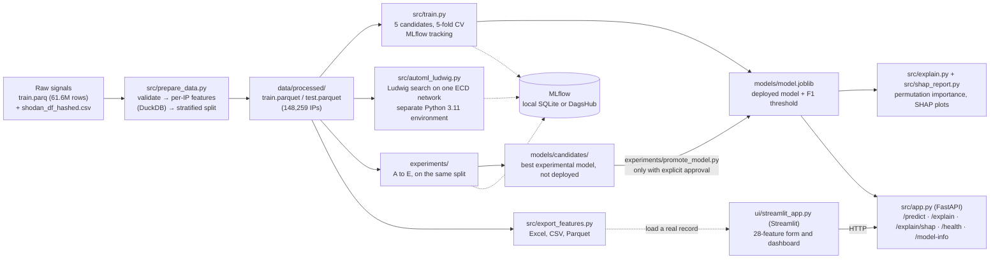
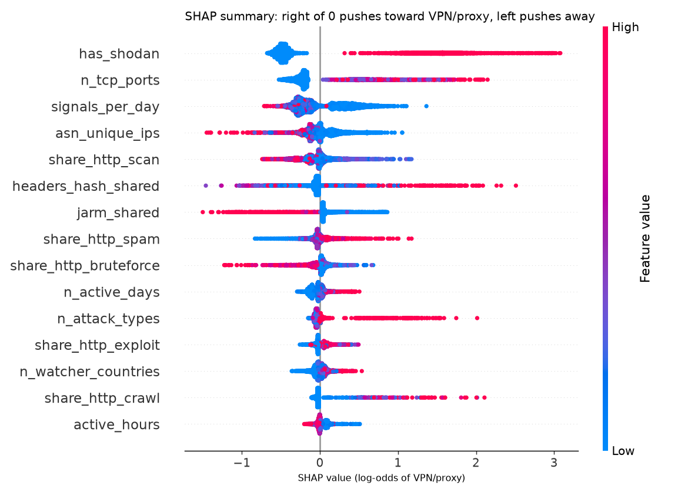

# VPN/Proxy IP Classifier

Predicts whether an attacker IP seen by CrowdSec is a VPN or proxy, from how that IP behaves across its attack signals. Served through a FastAPI endpoint.

**Task:** binary classification, one prediction per attacker IP.
**Metric:** F1 of the VPN/proxy class on a held-out test set of IPs. Only 1.95% of IPs are VPN/proxy, so accuracy is misleading: even the weakest model scores 98.4%.

**Guides:** [docs/OPERATIONS_GUIDE.md](docs/OPERATIONS_GUIDE.md) has the Windows commands for everything below. [docs/MILESTONE1_GUIDE.md](docs/MILESTONE1_GUIDE.md) explains the design decisions.

## Architecture



MLflow only records results. It doesn't choose or serve models: the API loads `models/model.joblib` directly.

Plain-text version:

```
data/raw/train.parq ─► prepare_data.py ─► data/processed/ ─► train.py ─► models/model.joblib ─► app.py (FastAPI)
  (61.6M signals)      validate + per-IP    (148,259 IPs,     5 models,     (best model +         /predict /explain
                       features + split      80/20 split)     MLflow        F1 threshold)          /health /docs
```

## Quick start

**On Windows, use [the Command Prompt instructions](docs/OPERATIONS_GUIDE.md).** `make` and the commands below are for Linux or macOS, and need [uv](https://docs.astral.sh/uv/).

```bash
git clone https://github.com/uzair-khiiba/VPN-Classifier-MLOps.git
cd VPN-Classifier-MLOps
make setup        # .venv with Python 3.12 and pinned dependencies
make serve        # API on http://127.0.0.1:8000, interactive docs at /docs
```

The trained model (`models/model.joblib`, ~300 KB) is committed, so the API runs straight after cloning.

To rebuild the model from scratch:

```bash
# Full data (see "Dataset" for the download): ~3 min prep + ~11 min training on 4 CPU cores
make data         # validate data/raw/train.parq, build per-IP features, split
make train        # train 5 candidates, log them to MLflow, save the best
make explain      # global explainability: permutation importance on the test set (~30 s)
make mlflow       # MLflow UI on http://127.0.0.1:5000, showing the experiment history

# Or, without the dataset: the same pipeline on the committed synthetic sample
make data SAMPLE=1 && make train SAMPLE=1
```

With `SAMPLE=1`, the outputs go to `data/processed-sample/` and `models/sample/`, so the committed model trained on the real data is never overwritten. MLflow logs these runs to a separate experiment, `vpn-proxy-classification-sample`.

Without `make`, the same steps are `python -m src.prepare_data`, `python -m src.train` and `uvicorn src.app:app`.

## Dashboard

A Streamlit dashboard, **Explainable VPN & Proxy Detector**, lets you enter an IP's 28 features by hand or load a real record, get a prediction, see why the model made it, review evaluation results and check the API's status. It reaches the model only through HTTP calls to the API. The full walkthrough is in [docs/UI_AND_API_GUIDE.md](docs/UI_AND_API_GUIDE.md).

On Windows, in Command Prompt from the project folder:

```bat
:: First time only
.venv\Scripts\python -m pip install -r requirements-ui.txt

:: Terminal 1: the API
.venv\Scripts\python -m uvicorn src.app:app --host 127.0.0.1 --port 8000

:: Terminal 2: the dashboard, at http://localhost:8501
.venv\Scripts\python -m streamlit run ui/streamlit_app.py
```

On Linux or macOS, `make setup-ui`, then `make serve` and `make ui` in two terminals.

Set `API_BASE_URL` if the API runs elsewhere. The default is `http://127.0.0.1:8000`, and `.env.example` shows the file option.

**The model needs 28 aggregated features, and this project has no IP lookup,** so an IP address alone can't be scored. The form asks for the features, and you can load real records from the export below, paste a row from Excel, or use the two labelled demos. The API serves `hgb_slow`. The experimental 400-tree model appears only as a labelled comparison.

## IP-level dataset in Excel

`python -m src.export_features` writes these to `data/exports/` (git-ignored, because they hold the real data):

| File | Contents |
|---|---|
| `ip_level_aggregated_features.xlsx` | All 148,259 IPs: ID, label, split, and the 28 features in API order. Has Instructions and Feature_guide sheets, a frozen header and filters |
| `ip_level_aggregated_features.parquet`, `.csv` | The same rows at full precision |
| `ip_level_sample_for_testing.xlsx`, `.csv` | 60 held-out IPs: 15 true positives, 15 false alarms, 15 missed, 15 true negatives |

Nothing is recalculated: values are read from `data/processed/`, the tables the model trained on. The workbook refuses to build from the small synthetic sample. On the IP Detection page, enter an `attacker_ip_enum` to load its exact values. [The operations guide](docs/OPERATIONS_GUIDE.md#test-an-ip-with-the-excel-workbook) has the steps.

## Dataset

[CrowdSec](https://www.crowdsec.net/) community data from the Kaggle VPN/proxy classification competition (Oct–Dec 2023).

| File | Contents |
|---|---|
| `train.parq` | 61,629,685 attack signals from 148,259 attacker IPs over one month (Jul 30 – Aug 29, 2023): attack time and type, attacker/watcher country and autonomous system, anonymised IP and watcher IDs, and `label` (1 = VPN/proxy) |
| `shodan_df_hashed.csv` | Shodan metadata per IP: open ports and hashed TLS/HTTP fingerprints (JARM, JA3S, header hash) |

Download both from Kaggle and place them in `data/raw/`. They are not committed: `train.parq` is 700 MB. Kaggle's `test.parq` has no labels and isn't used. Our test set is a held-out 20% of the labelled IPs.

`data/sample/` holds a small **synthetic** dataset with the same schema, for trying the pipeline without the download.

## How it works

**Unit of prediction.** The label belongs to the IP, but the data has one row per attack signal. `src/features.py` collapses each IP into one row of 28 behavioural features with DuckDB, which streams the 61.6M rows using about 6 GB of RAM:

- **Volume and timing:** signal count, active hours and days, signals per day, busiest hour, gaps between signals.
- **Breadth:** distinct attack types, watchers, watcher ASNs and countries, attacker ASNs.
- **Mix:** share of each of the 8 common attack types.
- **ASN crowding:** how many attacker IPs share this IP's ASN.
- **Shodan:** TCP and UDP port counts, and how many other IPs share this IP's JARM, JA3S or HTTP-header fingerprints.

The anonymised IP ID is never a model input.

**Leakage.** There is one row per IP, so the stratified 80/20 split cannot put the same IP in both train and test, and `split_by_ip` asserts this. Model and threshold selection use only 5-fold cross-validation on the training set; the test set is scored once per run, for reporting.

**Population counts are computed before the split, on purpose.** `asn_unique_ips`, `jarm_shared`, `ja3s_shared` and `headers_hash_shared` count across the whole raw files, including test IPs and Kaggle's unlabelled test IPs. They never read a label, so no label information leaks, but the test IPs' existence does affect them. Counted over training IPs only with one frozen table, test F1 moved from 0.7663 to 0.7608, with a difference interval of [−0.019, +0.007]. `python -m experiments.audit_population_features` reproduces the audit, and `--write-inductive` writes an alternative table without changing existing data or results. A deployed system must compute these counts the same way as training.

**Validation** (`src/prepare_data.py`). It checks that:
- the required columns exist
- the ID, time, type and label columns have no nulls
- labels are only 0 or 1, and each IP has a single label
- the attack-time range is valid
- the feature table has one row per IP, no NaNs and no negative values

It fails loudly otherwise.

**Imbalance.** All models use balanced class weights. Each model's probability threshold is then tuned to maximise F1 on its out-of-fold predictions. The defaults would be 0.5; the tuned thresholds are shown below.

## Experiments (MLflow)

Run history lives in two places, and they aren't automatically the same:

| Where | What's there |
|---|---|
| **Local:** `reports/experiments/artifacts/zainab_mlflow.db` | `zainab_experiments` (89 runs) and `zainab_ludwig_check` (1 run) |
| **Local:** `reports/experiments/artifacts/baseline/baseline_repro_mlflow.db` | `zainab_baseline_repro_local` (5 runs) |
| **Local:** `reports/experiments/artifacts/model_packages_mlflow.db` | `zainab_ludwig_trials` (the 20 trials, searchable) and `zainab_model_packages` (the 3 logged models) |
| **Remote:** [DagsHub MLflow](https://dagshub.com/uzair-khiiba/VPN-Classifier-MLOps.mlflow/#/experiments) | `vpn-proxy-classification` (5 original runs), `zainab_experiments_history` (the 89 runs), `zainab_ludwig_check` (1), `zainab_ludwig_trials` (21), `zainab_baseline_repro_local` (5). Model Registry: `vpn-proxy-classifier`, with aliases `production` (`hgb_slow`) and `candidate` (400 trees) |

The 116 copied runs were verified value by value on the server (`reports/experiments/results/dagshub_sync_report.json`). The name `zainab_experiments` is unusable on DagsHub's server, so those 89 runs are under `zainab_experiments_history`, with their original run names. The repository is public, so anything logged there is public. The `production` alias only records what's deployed: the API still loads `models/model.joblib`, and doesn't read the registry. The local databases are git-ignored. `src/train.py` logs to `mlflow.db` in the project root by default, which doesn't exist until you train. [The operations guide](docs/OPERATIONS_GUIDE.md#mlflow) shows how to view each store and publish history. Set `MLFLOW_TRACKING_URI` to log a new training run elsewhere, and never commit a token.

`src/train.py` logs one MLflow run per candidate to experiment `vpn-proxy-classification`, with parameters, cross-validated F1, the tuned threshold and test metrics (F1, precision, recall, PR-AUC, ROC-AUC, accuracy). The best run is tagged `best_model=true`.

Results on the full data (118,607 train IPs, 29,652 test IPs):

| Run | Model | CV F1 | **Test F1** | Precision | Recall | PR-AUC | Threshold |
|---|---|---|---|---|---|---|---|
| `hgb_slow` ✅ | HistGradientBoosting, lr 0.05, 600 iters, 63 leaves, L2 1.0 | **0.769** | **0.766** | 0.733 | 0.803 | 0.797 | 0.90 |
| `hgb` | HistGradientBoosting, lr 0.1, 300 iters | 0.766 | 0.761 | 0.732 | 0.792 | 0.781 | 0.91 |
| `rf` | RandomForest, 200 trees, unlimited depth | 0.761 | 0.750 | 0.708 | 0.798 | 0.804 | 0.34 |
| `rf_shallow` | RandomForest, 300 trees, depth 12 | 0.729 | 0.709 | 0.704 | 0.713 | 0.729 | 0.83 |
| `logreg` | Logistic regression on log1p + standardised features | 0.594 | 0.597 | 0.574 | 0.621 | 0.551 | 0.94 |
| `ludwig_automl` | Ludwig ECD neural net, best of 20 trials (2 × 64 layers, dropout 0.125, lr 0.0019), selected on validation ROC-AUC | 0.713* | 0.702 | 0.693 | 0.711 | 0.687 | 0.82 |

**Chosen model: `hgb_slow`.** It has the highest cross-validated F1, which is the selection rule. We picked it without looking at the test scores, and it also has the best test F1. It catches 80% of VPN/proxy IPs, and 73% of the IPs it flags really are VPN/proxy. The model file is 294 KB and predicts in milliseconds.

- **Logistic regression** trails by about 17 F1 points. The signal is non-linear: being in Shodan matters mostly together with shared fingerprints and a slow, spread-out attack pattern.
- **`rf`** has a slightly higher PR-AUC but lower F1 at its best threshold.
- **Ludwig** (\* F1 on a single validation split, not 5-fold CV) scored below `rf_shallow` on this run. Its 20-trial search maximised validation ROC-AUC (0.987), which ignores the decision threshold, and it trained on 94,885 IPs rather than 118,607. This is one configuration on one split, not evidence that Ludwig or neural networks are worse in general. An earlier version of this table showed test F1 0.711, but that run has no saved record, so it's been replaced.

**Deployed vs best experimental.** The table above covers `src/train.py` and the first Ludwig search. Later experiments found a better model, `exp_c_trees_400_no_early_stop` (CV F1 0.7885, test F1 0.7876), which is **not deployed**. [The verified comparison](reports/experiments/verified_model_comparison.md) lists every model with its confusion matrix and threshold, and explains how class imbalance affects them. Rebuild it with `python -m experiments.verified_comparison`, which stops if a score doesn't match its saved record.

**Changing the deployed model.** Models are logged to MLflow by `experiments.log_models`, but logging or registering a model never deploys it. `python -m experiments.promote_model <candidate> --approve --reason "..."` is the only supported route. It refuses a lower CV F1 whatever the test score, archives the current model and records the decision. Then restart the API.

## API

| Endpoint | Description |
|---|---|
| `GET /health` | Status, and whether the model is loaded, with its name and version |
| `GET /model-info` | The served model's identity and saved evaluation metrics |
| `POST /predict` | The 28 features of one IP → `prediction`, `label`, `is_vpn_proxy`, `probability`, the threshold and the model version |
| `POST /explain?top_k=8` | Median replacement, not SHAP: the prediction, plus how much the probability changes when each feature is replaced by its training median |
| `POST /explain/shap?top_k=28` | SHAP values for the VPN/proxy class from the served model, with the explainer that ran. They add up exactly to the model's log-odds |
| `GET /explain/shap/global` | The saved SHAP ranking, returned only if it was generated for the served model version |
| `GET /docs` | Auto-generated Swagger UI, with the two example IPs below preloaded |

Pydantic validates every field: counts must be ≥ 0 (or ≥ 1 where an IP always has one), shares and flags must be in [0, 1], all fields are required, and unknown fields are rejected. If no model is loaded, `/health` reports `degraded` and the model endpoints return 503. The reason goes to the server log, so clients never see file paths. `/explain` also reports whether resetting each feature would flip the class.

```bash
curl -X POST http://127.0.0.1:8000/predict -H "Content-Type: application/json" -d @examples/vpn_ip.json
# {"prediction":1,"label":"VPN/Proxy","is_vpn_proxy":true,"probability":0.9923,"threshold":0.9015,"model_version":"hgb_slow-20261019-173911"}

curl -X POST http://127.0.0.1:8000/predict -H "Content-Type: application/json" -d @examples/regular_ip.json
# {"prediction":0,"label":"Not VPN/Proxy","is_vpn_proxy":false,"probability":0.0055,"threshold":0.9015,"model_version":"hgb_slow-20261019-173911"}

curl -X POST "http://127.0.0.1:8000/explain?top_k=3" -H "Content-Type: application/json" -d @examples/vpn_ip.json
# contributions: has_shodan +0.394, headers_hash_shared +0.058, n_tcp_ports +0.054
```

`examples/` contains two typical IPs from the held-out test set: a VPN/proxy IP and a regular one.

## Explainability

The model is explained at two levels, with two methods at each. All of them describe how the model behaves. **None of them shows that a feature causes an IP to be a VPN or proxy.**

**Global: which features the model relies on.** `make explain` runs `src/explain.py`, which computes permutation importance on the 29,652 held-out test IPs. It shuffles one feature at a time, which breaks that feature's link to the label, and measures how much test F1 drops at the model's own threshold. Each feature is shuffled 5 times. The results are in `models/feature_importance.json` and the chart below.


| Rank | Feature | Test F1 drop when shuffled |
|---|---|---|
| 1 | `has_shodan` | 0.445 |
| 2 | `n_tcp_ports` | 0.348 |
| 3 | `headers_hash_shared` | 0.247 |
| 4 | `asn_unique_ips` | 0.110 |
| 5 | `share_http_scan` | 0.039 |

The Shodan view of an IP dominates: whether Shodan saw it at all, how many TCP ports are open, and how many other IPs share its HTTP header fingerprint. VPN and proxy servers run the same software on the same ports, so they share fingerprints. ASN crowding comes next, since hosting and VPN networks contain many attacker IPs. The attack-timing features add comparatively little once those are known.

**Local: why this IP got this prediction.** `POST /explain` replaces one feature at a time with its training median, re-predicts, and reports how much the probability changes. For the VPN example, `has_shodan=1` adds +0.39 and `headers_hash_shared=690` adds +0.06. Both of these methods are model-agnostic, so they work unchanged for any model the pipeline selects.

**SHAP.** `shap.TreeExplainer` (tree-path-dependent) explains the deployed `hgb_slow` and the experimental 400-tree model on the installed versions (shap 0.54.1, scikit-learn 1.9.1). Values are in log-odds of the VPN/proxy class. Every call checks that the base value plus the SHAP values equals the model's own log-odds, and fails rather than returning values that don't add up. A model SHAP can't read as trees falls back to `PermutationExplainer`, and the response names whichever ran.

- **Global:** `python -m src.shap_report` explains all 29,652 test IPs and writes `shap_summary.png`, `shap_bar.png`, `shap_ranking.csv`, `shap_global.json` and two local examples to `reports/figures/shap/<model>/`. For `hgb_slow`, the top features are `has_shodan`, `n_tcp_ports` and `signals_per_day`. Its ranking has a Spearman correlation of 0.83 with permutation importance. They differ because SHAP measures how much a feature moves the score, while permutation importance measures how much F1 depends on it.
- **Local:** `POST /explain/shap`, shown on the IP Detection and Explainability pages.



## Hyperparameter search with Ludwig

**What this is:** the architecture family is fixed by us as one ECD neural network, and [Ludwig](https://ludwig.ai/) tunes its settings. It doesn't compare Random Forest, Logistic Regression or other families, and doesn't choose features, so it's hyperparameter optimisation rather than full AutoML.

The config defines a tabular network on the same 28 features, with a search over:
- learning rate and batch size
- number of layers, layer width and dropout
- the positive-class loss weight

There are two configurations, and only the first has had a full run:

| | `configs/ludwig_automl.yaml` (first search) | `configs/ludwig_automl_v2.yaml` (current default) |
|---|---|---|
| Status | **Run:** 20 of 20 trials finished, test F1 0.7020 | **Not yet run in full** |
| Trials | 20 | 30 |
| Random startup trials | 20 (the default), so TPE never started | 10 |
| Adaptive TPE trials | 0: random search. Confirmed on the real searcher object (`n_startup_jobs` = 20) | Up to 20. Ludwig drops the setting when loading a config, so the script applies it to the searcher, stops if that fails, and records the measured count |
| Search objective | Validation ROC-AUC | Validation PR-AUC, with ROC-AUC still recorded |
| Final retrain | `early_stop: 5`, unlike the trials | No early stopping, like the trials |
| Trial tracking | A JSON file on one run, later backfilled | One nested MLflow run per trial, plus retries and failures |
| Results folder | `ludwig_results/` | `ludwig_results_v2/`, and an existing folder is refused |

**Why PR-AUC.** Ludwig has no PR-AUC for binary outputs, so `src/ludwig_metrics.py` adds it, using the same definition as scikit-learn. Across 72 runs on the same folds, CV PR-AUC tracks CV F1 far better than ROC-AUC (Spearman 0.926 vs 0.631; see `reports/experiments/results/objective_comparison.json`). Those are tree models, so this is evidence about the metrics on this data, not a Ludwig result. Direct F1 was rejected because Ludwig would measure it at 0.5, while this project tunes the threshold afterwards.

In both, the test set isn't given to the search, and the threshold is tuned on validation only. Validation also picks the best epoch, so that threshold is slightly optimistic.

```bash
make setup-automl          # separate .venv-ludwig: Ludwig 0.11.0 + PyTorch (CPU) + Ray, ~2 GB
make automl                # the v2 search: expect 1-2 hours on 4 CPU cores (TRIALS=n for fewer)
```

Ludwig has its own environment because of its size; the API doesn't need it. 0.11.0 is the last Ludwig release that supports Python 3.11. `src/automl_ludwig.py` disables one Ludwig 0.11 post-search step that crashes when re-evaluating trials ASHA stopped early; the runner retrains and evaluates the best trial itself instead.

## Tests

```bash
make test         # pytest. Tests that need the real export or data are skipped if it's absent
make lint         # ruff
```

| File | Covers |
|---|---|
| `tests/test_prepare_data.py` | Validation (missing columns, null IDs, bad or conflicting labels, time-zone-aware timestamps), hand-checked feature values, Shodan parsing and fingerprint sharing, split leakage and stratification, end-to-end `prepare()` |
| `tests/test_model_io.py` | Model bundle save/load round trip; missing, corrupt and invalid files; bad thresholds; the committed `models/model.joblib` loads and classifies both example IPs correctly |
| `tests/test_app.py` | `/health` with and without a model, `/predict` output, 422 on invalid or missing or extra fields, `/explain` ordering, `/docs`, docs examples are valid requests |
| `tests/test_api_extended.py` | Labels, `/model-info`, no file paths in errors, infinite values rejected, one model load, API documentation |
| `tests/test_ui_client.py` | The dashboard's HTTP client against the real API, backend down, invalid responses, and that `ui/` never imports the model |
| `tests/test_ui_app.py` | Every dashboard page run headlessly, including offline and no-model behaviour |
| `tests/test_explain.py` | Permutation importance ranks the one informative feature first; the F1 scorer respects the threshold; the chart is written |
| `tests/test_automl_config.py` | Both Ludwig configs match the pipeline's features; v2 has adaptive trials and a PR-AUC objective; retraining matches trials (no Ludwig install needed) |
| `tests/test_export_features.py` | The export keeps training values and feature order, refuses the synthetic sample, and real rows get the same answer through the API |
| `tests/test_shap.py` | SHAP explains class 1 and adds up to the model; missing values; feature order; explainer fallback; the API endpoints; plots; the real served model |
| `tests/test_mlflow_publish.py` | History copy: no duplicates, resuming, failures, verification. Model logging and reload. Promotion refusals. The deployed model's hash. Nested trials |

## Repository layout

```
src/            config, features, feature_docs, prepare_data, export_features, train, model_io, app (FastAPI),
                explain, shap_explain, shap_report, automl_ludwig, ludwig_metrics, ludwig_trials
ui/             Streamlit dashboard: streamlit_app, api_client (HTTP), features, reports, shap_view, views/
tests/          pytest suite and synthetic-data fixtures
configs/        Ludwig configs and experiment settings
experiments/    experiments A to F, verified comparison, history publishing, model logging and promotion
data/sample/    small synthetic dataset (raw data goes in data/raw/, not committed)
data/exports/   generated IP-level Excel, CSV and Parquet (not committed)
models/         model.joblib (deployed model), model_meta.json, feature_importance.json, candidates/ (not committed)
reports/        experiment report, verified comparison, figures, SHAP plots
examples/       example request bodies
```

## Credits

- Feature ideas, including fingerprint sharing, ASN crowding and attack timing, are adapted from the public 2nd-place solution notebook of the CrowdSec Kaggle competition ("crowdsec-vpn-classification-2nd-place"). Our code is a reimplementation, not a copy.
- Libraries: scikit-learn, DuckDB, pandas, PyArrow, MLflow, FastAPI, Pydantic, Uvicorn, pytest, Ruff, Streamlit and Altair for the dashboard, SHAP and Matplotlib for explanations, XlsxWriter for the export, DagsHub for hosted tracking, and Ludwig, Ray and PyTorch for the optional search.
- See `AI_USAGE.md` for how AI assistants were used.

## License

MIT, see `LICENSE`. Team and contributions: `CONTRIBUTION.md`.
