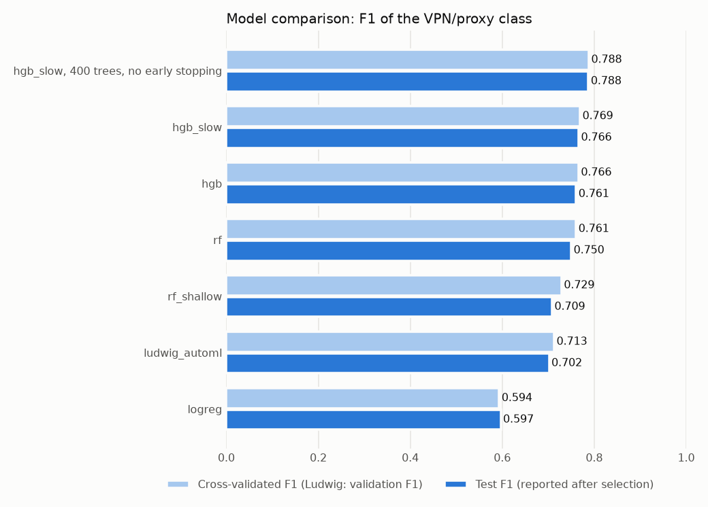
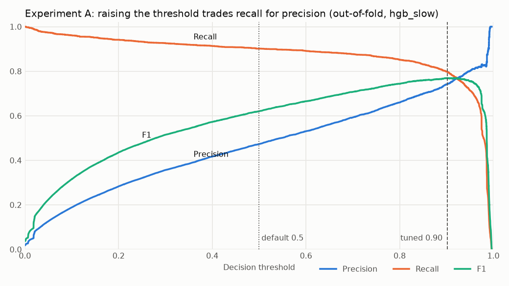
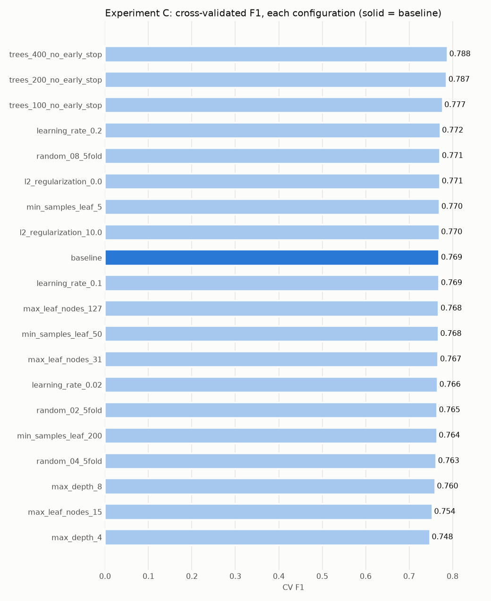
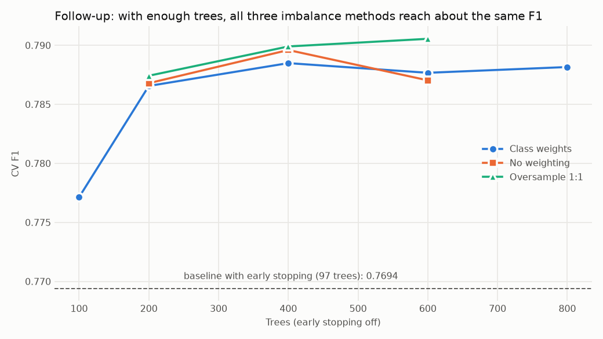
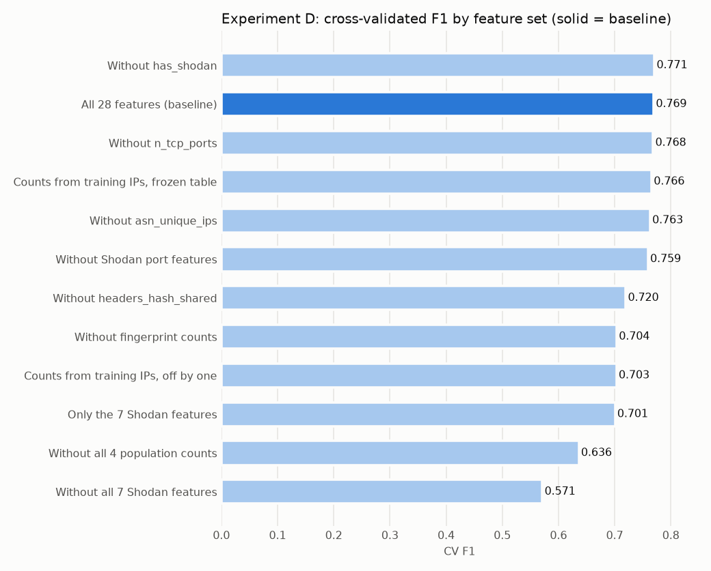
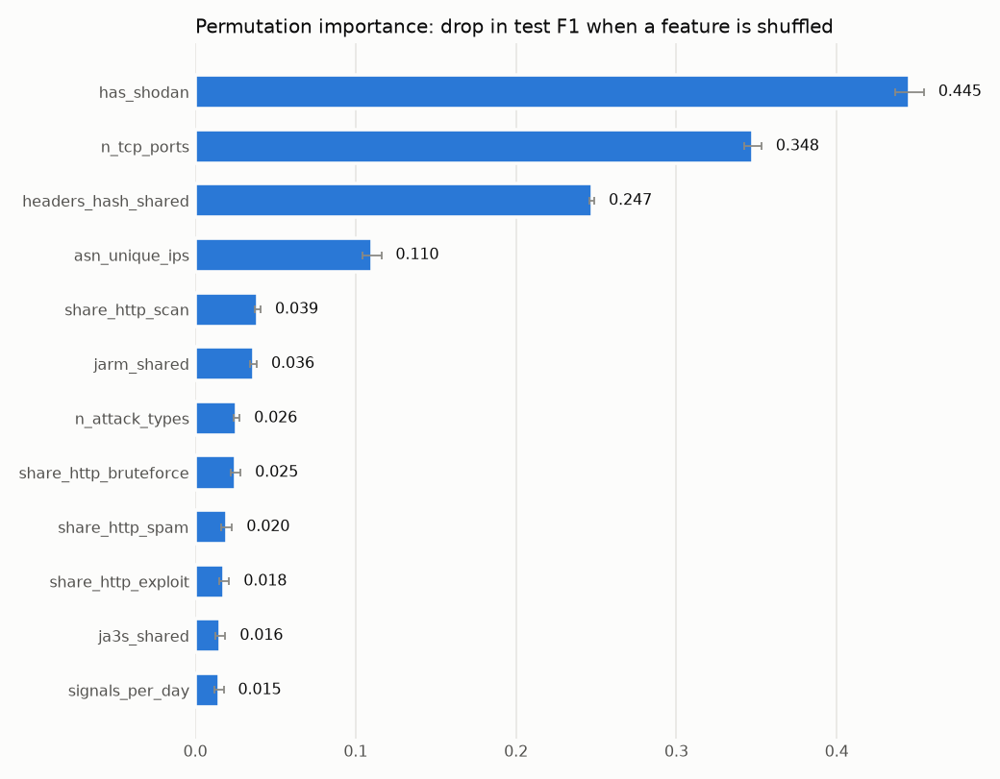
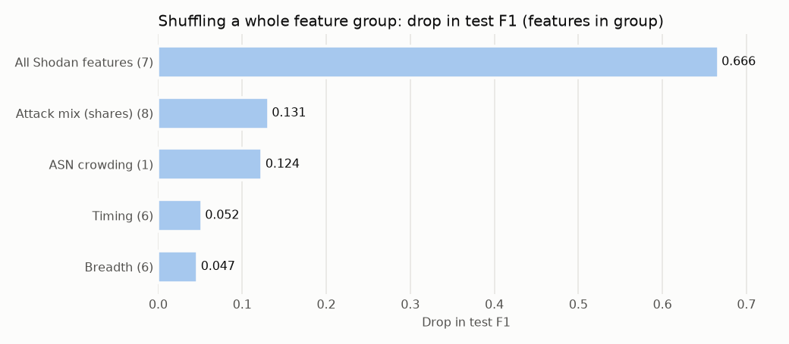
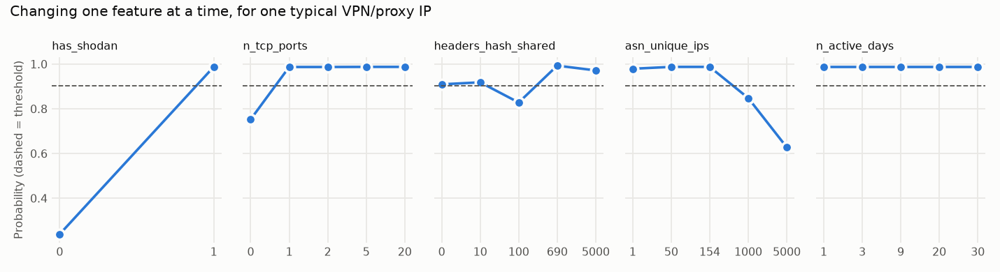

# Final experiment report: improving the VPN/proxy classifier

All numbers come from real runs on the CrowdSec data, using the same train/test split as the baseline (test IP hash `7a8a6674be67b514`). Full tables are in [comparison_tables.md](comparison_tables.md).

## Summary

- **The baseline reproduced exactly.** All 5 models match the documented scores to 4 decimal places.
- **The experiments improved the model.** Test F1 rose from **0.7663 to 0.7876**, a gain of +0.021 (95% interval +0.003 to +0.037). The low end of that interval is close to zero, so the true gain could be small.
- **The biggest finding was a hidden default.** `hgb_slow` was documented as 600 trees but built only 94, because scikit-learn's early stopping turned on automatically. Turning it off and using 400 trees gave the gain.
- **Most other changes made no clear difference.** That includes learning rate, regularisation, random search and oversampling. Ludwig AutoML was clearly worse.
- **The model depends heavily on Shodan.** Without the 7 Shodan features, test F1 falls to 0.592.
- **The original project is untouched.** The served model is still `hgb_slow`. Adopting the new model is a decision for you and your team.

## How the experiments were kept fair

| Rule | How it was enforced |
|---|---|
| Same data | One split for everything, with its hash recorded |
| Same folds | `StratifiedKFold(5, shuffle=True, random_state=42)`, the same as `src/train.py` |
| Selection without test data | Configurations compared on out-of-fold (OOF) predictions, and selections saved to `selections.json` before any new test prediction |
| Resampling without leakage | Applied only to the training part of each fold |
| Differences can be chance | Test differences reported with a paired bootstrap 95% interval |

An **OOF prediction** is a prediction for a training IP from a model that was fitted without it, which makes it a fair stand-in for unseen data.

`experiments/audit_selection.py` tries to find contamination, and all 48 of its checks pass. Selections stay identical when every test metric is deleted or replaced with random numbers. The limits of that audit:

- The baseline's test scores were already public in the README before the experiments began.
- The original project's choices of features and settings can't be audited.
- The final selection rule was written after seeing CV results, though before any new test scoring.
- About 50 configurations were scored on test, so **only the selected model's test score is a fair estimate**. The others are retrospective.

## Results at a glance

Precision, recall, F1 and PR-AUC are on the test set. Fit time is one fit on all training IPs.

| Experiment | Model | Main change | Precision | Recall | F1 | PR-AUC | Threshold | Fit time |
|---|---|---|---:|---:|---:|---:|---:|---:|
| **Baseline** | `hgb_slow` | None (94 trees) | 0.733 | 0.803 | **0.7663** | 0.797 | 0.901 | 29 s |
| **C (selected)** | HGB | **400 trees, no early stopping** | **0.786** | **0.789** | **0.7876** | **0.845** | 0.828 | 39 s |
| A | `hgb_slow` | Default threshold 0.5 | 0.453 | 0.908 | 0.6041 | 0.797 | 0.500 | 25 s |
| B | HGB | No class weights | 0.764 | 0.791 | 0.7772 | 0.846 | 0.318 | 9 s |
| B | HGB | Oversample 1:1 | 0.755 | 0.810 | 0.7813 | 0.844 | 0.652 | 39 s |
| B | HGB | Undersample 1:1 | 0.713 | 0.734 | 0.7229 | 0.730 | 0.998 | 14 s |
| C | HGB | Best random search finalist (`random_08`) | 0.759 | 0.811 | 0.7843 | 0.798 | 0.884 | 22 s |
| C2 | HGB | 800 trees, class weights | 0.795 | 0.787 | 0.7913 | 0.847 | 0.718 | 56 s |
| C2 | HGB | 400 trees, no weights | 0.765 | 0.811 | 0.7876 | 0.847 | 0.255 | 18 s |
| C2 | HGB | 600 trees, oversample 1:1 | 0.789 | 0.798 | 0.7935 | 0.845 | 0.728 | 36 s |
| D | `hgb_slow` | Without Shodan features | 0.552 | 0.638 | 0.5923 | 0.599 | 0.904 | 25 s |
| D | `hgb_slow` | Only Shodan features | 0.768 | 0.723 | 0.7451 | 0.705 | 0.947 | 7 s |
| D | `hgb_slow` | Counts from training IPs only | 0.757 | 0.765 | 0.7608 | 0.795 | 0.925 | n/a |
| E | `hgb` | Original candidate | 0.732 | 0.792 | 0.7608 | 0.781 | 0.915 | 20 s |
| E | `rf` | Original candidate | 0.708 | 0.798 | 0.7502 | 0.804 | 0.340 | 23 s |
| E | `rf_shallow` | Original candidate | 0.704 | 0.713 | 0.7085 | 0.729 | 0.827 | 36 s |
| E | `logreg` | Original candidate | 0.574 | 0.621 | 0.5968 | 0.551 | 0.939 | 1 s |
| F | Ludwig | Neural net, best of 20 trials | 0.693 | 0.711 | 0.7020 | 0.687 | 0.822 | About 32 min search |



## Experiment A: decision threshold

**Question:** is 0.5 the right cut-off? **Hypothesis:** no, because balanced class weights push probabilities up. **Changed:** the threshold only. **Fixed:** the model and its predictions.

| Threshold | CV precision | CV recall | CV F1 | Test F1 | Test false alarms | Test missed |
|---:|---:|---:|---:|---:|---:|---:|
| 0.10 | 0.188 | 0.961 | 0.3151 | 0.2837 | 2,822 | 16 |
| 0.30 | 0.356 | 0.926 | 0.5147 | 0.4841 | 1,110 | 39 |
| 0.50 | 0.473 | 0.901 | 0.6201 | 0.6041 | 635 | 53 |
| 0.70 | 0.593 | 0.877 | 0.7071 | 0.6875 | 388 | 72 |
| 0.80 | 0.660 | 0.851 | 0.7432 | 0.7315 | 277 | 85 |
| 0.90 | 0.741 | 0.798 | 0.7686 | 0.7638 | 173 | 114 |
| **0.901 (tuned)** | 0.743 | 0.798 | 0.7694 | 0.7663 | 169 | 114 |



**Result: the hypothesis held.** The best threshold is far from 0.5. Moving from 0.5 to 0.901 removes 466 false alarms and adds 61 missed VPNs on test.

**What it means:** the threshold doesn't make the model better at ranking IPs, so PR-AUC stays at 0.797 throughout. It only chooses where to accept mistakes. The right choice depends on which mistake costs more, and F1 assumes they matter equally.

**A subtle point:** tuning a threshold on the same predictions you score flatters the result slightly. Tuning on the other folds gives 0.7654 instead of 0.7694, so that optimism is about 0.004.

## Experiment B: class imbalance

**Question:** which imbalance method works best? **Hypothesis:** similar F1 across methods, and undersampling worse because it throws data away. **Changed:** weighting or resampling, inside training folds only. **Fixed:** other model settings, features and folds. The pipeline itself uses only class weights.

| Method | Trees used | CV F1 | CV precision | CV recall | CV PR-AUC | Test F1 | F1 vs baseline [95% interval] |
|---|---:|---:|---:|---:|---:|---:|---:|
| Oversample 1:1 | 600 (never stopped) | 0.7913 | 0.772 | 0.812 | 0.842 | 0.7813 | +0.015 [−0.001, +0.031] |
| Oversample 1:10 | 600 (never stopped) | 0.7849 | 0.745 | 0.829 | 0.841 | 0.7780 | +0.012 [−0.004, +0.028] |
| No weighting | 136 | 0.7784 | 0.766 | 0.791 | 0.835 | 0.7772 | +0.011 [−0.005, +0.027] |
| Oversample 1:1, held to 94 trees | 94 | 0.7731 | 0.744 | 0.804 | 0.794 | 0.7623 | −0.004 [−0.013, +0.006] |
| Undersample 1:10 | 115 | 0.7703 | 0.754 | 0.788 | 0.806 | 0.7659 | −0.000 [−0.016, +0.015] |
| Class weights (baseline) | 97 | 0.7694 | 0.743 | 0.798 | 0.777 | 0.7663 | baseline |
| Undersample 1:1 | 600 (never stopped) | 0.7189 | 0.696 | 0.744 | 0.714 | 0.7229 | −0.044 [−0.065, −0.023] |

**Result:** undersampling 1:1 is clearly worse, as predicted. But oversampling's apparent win was misleading. Copies of the same row land in both the training data and early stopping's internal validation set, so validation loss kept improving and training ran to the 600-tree limit. Held to 94 trees, the advantage disappears. **Oversampling was really a hidden way of getting more trees.**

**Does more recall cost precision?** Here, it doesn't have to. Each option's threshold is tuned for F1, so all sit at a similar balance. Among these options, the gains came from better ranking (higher PR-AUC), not from moving along the trade-off.

## Experiment C: hyperparameters

**Question:** can tuning beat the baseline? **Hypothesis:** only slightly. **Changed:** one parameter at a time, then a 20-configuration random search. **Fixed:** features and imbalance method. **Rule set before any results:** a challenger must beat the baseline's CV F1 by more than 0.003.



| Change from baseline | CV F1 | Test F1 | F1 vs baseline [95% interval] |
|---|---:|---:|---:|
| **400 trees, no early stopping** | **0.7885** | **0.7876** | **+0.021 [+0.003, +0.037]** |
| 200 trees, no early stopping | 0.7866 | 0.7718 | +0.006 [−0.007, +0.018] |
| 100 trees, no early stopping | 0.7771 | 0.7625 | −0.004 [−0.017, +0.011] |
| Learning rate 0.2 | 0.7717 | 0.7584 | −0.008 [−0.020, +0.005] |
| L2 regularisation 0 | 0.7711 | 0.7616 | −0.005 [−0.012, +0.003] |
| Random search finalist `random_08` | 0.7715 | 0.7843 | +0.018 [+0.006, +0.029] |
| Max leaf nodes 127 | 0.7684 | 0.7789 | +0.012 [+0.001, +0.024] |
| Max depth 4 | 0.7481 | 0.7430 | −0.023 [−0.040, −0.007] |

**Result: my hypothesis was wrong.** Tuning the usual parameters did little, but removing early stopping did a lot, lifting CV PR-AUC from 0.777 to 0.841. Random search missed it completely, because every configuration it tried kept early stopping on. **A search can only find what its search space includes.**

**Why might early stopping hurt?** Two effects show in the data, though neither is proven as the cause:

- **Data held back.** Early stopping sets aside 10% of training data. At nearly the same tree count (100 vs about 97), turning it off raises CV F1 by about 0.008.
- **Stopping too soon.** Going from 100 to 400 trees adds about 0.011. Early stopping watches weighted log-loss, while F1 and ranking kept improving after the loss stopped. This mismatch is a likely explanation that wasn't tested directly.

**Be careful with test-only wins.** `max_leaf_nodes_127` and `random_08` beat the baseline on test, but CV showed `max_leaf_nodes_127` slightly below the baseline and `random_08` only 0.002 above it. With about 50 comparisons, some wins will be chance.

## Follow-up C2: separating trees from imbalance method

B and C raised a question: was it the method or the tree count? This follow-up fixed the tree count, with early stopping off. It ran on CV before any new test scoring.



| Trees | Class weights (CV F1) | No weights (CV F1) | Oversample 1:1 (CV F1) |
|---:|---:|---:|---:|
| 200 | 0.7866 | 0.7868 | 0.7874 |
| 400 | 0.7885 | 0.7896 | 0.7899 |
| 600 | 0.7877 | 0.7870 | 0.7905 |

**Result:** with enough trees, the imbalance method hardly matters, and all three settle near 0.79.

**Final selection rule:** highest 5-fold CV F1, must beat the baseline by the margin, and the simplest option within 0.003 of the best wins. The rule chose **400 trees with class weights**. It tied with 400 trees and no weights, which the rule hadn't anticipated, and list order settled the tie. The tie-break happens to change only one thing from the baseline.

## Experiment D: features and Shodan

**Question:** how much does the model rely on Shodan, and is any of it leakage? **Hypothesis:** a large drop without Shodan, and a smaller one when counts use training IPs only. **Changed:** the feature set. **Fixed:** the model and folds, using the baseline's settings throughout.

The 7 Shodan features are `has_shodan`, `n_tcp_ports`, `n_udp_ports`, `jarm_shared`, `ja3s_shared`, `headers_hash_shared` and `no_print_with_ports`.



| Feature set | CV F1 | Test precision | Test recall | Test F1 | F1 vs baseline [95% interval] |
|---|---:|---:|---:|---:|---:|
| All 28 | 0.7694 | 0.733 | 0.803 | 0.7663 | baseline |
| Without `has_shodan` | 0.7707 | 0.715 | 0.808 | 0.7587 | −0.008 [−0.016, +0.001] |
| Without `n_tcp_ports` | 0.7684 | 0.756 | 0.772 | 0.7637 | −0.003 [−0.016, +0.011] |
| Without `asn_unique_ips` | 0.7629 | 0.786 | 0.742 | 0.7633 | −0.003 [−0.020, +0.013] |
| Without the 4 port features | 0.7592 | 0.741 | 0.766 | 0.7534 | −0.013 [−0.029, +0.002] |
| Without `headers_hash_shared` | 0.7196 | 0.649 | 0.806 | 0.7191 | −0.047 [−0.067, −0.028] |
| Without the 3 fingerprint counts | 0.7036 | 0.695 | 0.739 | 0.7164 | −0.050 [−0.071, −0.028] |
| Only the 7 Shodan features | 0.7006 | 0.768 | 0.723 | 0.7451 | −0.021 [−0.041, −0.001] |
| Without the 4 population counts | 0.6362 | 0.578 | 0.716 | 0.6399 | −0.127 [−0.151, −0.101] |
| **Without all 7 Shodan features** | **0.5713** | **0.552** | **0.638** | **0.5923** | **−0.174 [−0.204, −0.143]** |

**Findings:**

- **The model depends heavily on Shodan as a group, but single features are replaceable.** Removing `has_shodan` changes almost nothing, because `n_tcp_ports` carries the same information. Removing all 7 loses about a fifth of F1.
- **Shodan alone is not enough either.** It reaches only 0.70 on CV, so behaviour features add real value. The test score here (0.745) sits well above CV, which is a reminder of how much a single split can vary.
- **Fingerprint sharing is the feature family that can't be replaced.** Removing it lowers precision, so the model raises more false alarms.

**Is this leakage?**

| Concern | Finding |
|---|---|
| Does having a Shodan row reveal the label? | No. All 148,259 IPs have a row, in both classes |
| Does any single feature give the label away? | No clear sign. The strongest alone reaches AUC 0.900 |
| Were labels built from Shodan? | **Unknown.** The data doesn't record how labels were made. This should be asked, because it decides whether Shodan's power is genuine |
| Is Shodan available when predicting? | Only if a similar snapshot exists. The file has no timestamps, so we can't confirm it predates the attacks |
| Do counts use test IPs? | **Yes**, with no labels involved. This inflates the score very little (below) |

**Testing the count features.** Four features count across all IPs, including test IPs and 49,420 Kaggle test IPs. I rebuilt them from training IPs only:

| Version | CV F1 | Test F1 | F1 vs baseline [95% interval] |
|---|---:|---:|---:|
| Original (counts use all IPs) | 0.7694 | 0.7663 | baseline |
| Training IPs only, one frozen lookup table | 0.7656 | 0.7608 | −0.006 [−0.019, +0.007] |
| Training IPs only, training rows count "others" and new rows count "all" | 0.7031 | 0.6930 | −0.073 [−0.094, −0.054] |

My first attempt was the bottom row, and it looked alarming. It turned out that a difference of one in the count caused most of the drop. With a consistent lookup table, the effect is no longer clearly different from zero.

**This also exposes a real risk.** An offset of one shouldn't matter to a meaningful count, yet it cost about 0.06 F1. A likely explanation is that exact values act like an ID for a fingerprint group, so the model learns "count 690 means this VPN group". That hasn't been proven. In practice, **these features must be computed identically in training and serving**, and the API currently accepts them without saying how to produce them.

## Experiment E: model comparison

**Question:** why do some algorithms win? **Hypothesis:** trees beat linear models because the signal comes from feature interactions. **Changed:** the algorithm. **Fixed:** features and folds.

| Model | CV F1 | Test F1 | PR-AUC | Size | F1 vs baseline [95% interval] |
|---|---:|---:|---:|---:|---:|
| `hgb_slow` | 0.7694 | 0.7663 | 0.797 | 287 KB | baseline |
| `hgb` | 0.7661 | 0.7608 | 0.781 | 130 KB | −0.005 [−0.018, +0.007] |
| `rf` | 0.7607 | 0.7502 | 0.804 | 10,355 KB | −0.016 [−0.032, +0.000] |
| `rf_shallow` | 0.7291 | 0.7085 | 0.729 | 6,092 KB | −0.058 [−0.077, −0.038] |
| `logreg` | 0.5936 | 0.5968 | 0.551 | 2 KB | −0.169 [−0.199, −0.140] |

**Result:** the hypothesis fits the evidence. Logistic regression can only add up feature effects, and it falls far behind. All tree models do better, and limiting forest depth hurts. This supports an interaction story, but doesn't prove it.

`hgb_slow`'s win over `hgb` was within noise: the fold-to-fold spread of F1 is about ±0.02. `hgb_slow` is also about 36 times smaller than `rf`, which matters when serving.

## Experiment F: Ludwig AutoML

**Feasibility:** it needed work, but it ran. Ludwig 0.11 needs Python 3.11, so it has its own 1.9 GB environment. On Windows, every trial first crashed at the end, because Ludwig calls `fsync` on a read-only file. [patch_ludwig_windows.py](../../experiments/patch_ludwig_windows.py) fixes that line inside `.venv-ludwig` only.

| Item | Value |
|---|---|
| Search | Project's unmodified config: Ray Tune, hyperopt configured for TPE, ASHA early stopping, 2 trials at a time, 1-hour budget. **Correction:** hyperopt's default of 20 random startup points used up all 20 trials, so TPE's adaptive stage never ran, and this was effectively random search |
| Trials | 20. Two hit a Windows file-permission error in Ray's temp folder, yet the final status lists all 20 as terminated, with 20 scores |
| Runtime | About 32 minutes for the search, 36 minutes including the final retrain. My audit and sync jobs ran during this, so treat it as approximate |
| Best settings | Learning rate 0.0019, batch size 1024, 2 layers of 64, dropout 0.125, positive class weight 10 |
| Validation | ROC-AUC 0.9867, F1 0.7131 |
| Test | Precision 0.693, recall 0.711, **F1 0.7020**, PR-AUC 0.687, threshold 0.822 |
| Compared with baseline | **−0.065 [−0.089, −0.041], clearly worse** |
| Model size | 101 KB |

**Did it reproduce the documented 0.711?** No. It scored 0.702 with different best settings. The Ludwig run isn't in DagsHub's experiment, so there's no tracked record to compare against. Ray's parallel scheduling may contribute, but I didn't isolate a cause.

**A useful lesson:** my 2-trial check scored higher on test (0.7071) than the 20-trial search (0.7020), despite a slightly lower ROC-AUC. The search optimises ROC-AUC, which can't see the decision threshold or the rare class's precision well. **More search doesn't help much if the objective isn't what you care about.** Comparing it fairly also has limits: Ludwig trains on 80% of the training IPs because it keeps a validation split, and it got one single split rather than 5 folds.

## Explainability

These results use the project's own methods on the committed `hgb_slow`. **SHAP is not used.**

**Global: permutation importance.** Shuffle a feature, then measure how much test F1 drops. The results match `models/feature_importance.json` exactly.



**Groups.** Correlated features can cover for each other, so I also shuffled whole groups:

| Group | Features | Test F1 drop |
|---|---:|---:|
| All Shodan | 7 | 0.666 |
| Attack mix | 8 | 0.131 |
| ASN crowding | 1 | 0.124 |
| Timing | 6 | 0.052 |
| Breadth | 6 | 0.047 |



**Two methods, two different questions:**

| Feature | Permutation importance | Removing it and retraining |
|---|---:|---:|
| `has_shodan` | Largest drop, 0.445 | −0.008, no clear change |

Permutation asks "how much does *this trained model* use this feature?". Removal asks "can a new model manage without it?". Here the answers differ, because `n_tcp_ports` can take over. Permutation also creates impossible rows, such as `has_shodan=0` with open ports.

**Per-IP explanations from `/explain`:**

| Outcome | Probability | Top reason given |
|---|---:|---|
| Confident correct VPN | 0.9927 | `has_shodan=1` adds +0.67, 2 TCP ports +0.14, `headers_hash_shared=690` +0.08 |
| Confident false alarm | 0.9927 | The same pattern: `has_shodan=1`, 2 TCP ports, `headers_hash_shared=690` |
| Confident missed VPN | 0.0052 | Almost no feature moves the score; the largest effect is −0.007 |

The first two rows show why some mistakes can't be fixed by tuning. A real VPN and a false alarm can look identical on these features, because a shared HTTP fingerprint isn't exclusive to VPNs.

**Who gets missed?** Of the 114 missed VPNs, 13 have no Shodan data at all, and the missed group's median `headers_hash_shared` is 10.5 against 690 for those caught. These IPs lack the main signal the model relies on.

**Changing one feature at a time,** for a typical correctly flagged IP:



- `has_shodan` from 1 to 0 drops the probability from 0.99 to 0.24.
- `headers_hash_shared` is **not smooth**: 0 gives 0.91, 100 gives 0.83, and 690 gives 0.99. This fits the concern that exact counts act like group IDs.
- A very crowded ASN lowers the probability: 5,000 IPs gives 0.63.
- `n_active_days` has no effect for this IP, although the median differs between classes (9 vs 3).

**Do these make sense?** Mostly. VPN servers run the same software on open ports, so scanners see them and they share fingerprints. The non-smooth count needs caution.

**Limitations:**
- These methods describe the model, not the real world, so they don't show causes.
- Median replacement can create impossible combinations.
- A single IP's what-if results don't generalise.
- Permutation importance on test measures reliance, and wasn't used to select anything.

## Final answers

| Question | Answer |
|---|---|
| Best by validation F1 | `oversample_1to1`, CV F1 0.7913, helped by the early-stopping side effect |
| Best by test F1 (**retrospective**, not a selection rule) | `oversample_1to1_trees_600`, test F1 0.7935 |
| Best for high recall | The selected model at threshold 0.173: recall 0.907, precision 0.527, 54 missed |
| Best for high precision | The selected model at threshold 0.984: precision 0.901, recall 0.597, 38 false alarms |
| Best overall trade-off | **400 trees, no early stopping, threshold 0.828** |
| Did experiments improve the baseline? | **Yes**: +0.021 test F1, with 45 fewer false alarms and 8 more missed |

**Costs of the selected model, measured on an idle CPU:**

| Measure | Baseline | Selected |
|---|---:|---:|
| Trees | 94 | 400 |
| Size | 287 KB | 1,244 KB |
| One IP | 13.6 ms | 20.4 ms |
| All 29,652 test IPs | 0.20 s | 0.93 s |

These costs are small for this service. The real cost of change is process: the served model, its documentation and its tests would all need updating.

**What wasn't useful:**
- Tuning learning rate, L2 and min samples per leaf.
- Random search, as configured.
- Oversampling once tree count is accounted for.
- Undersampling 1:1.
- Ludwig on this task and budget.

**What should be considered for Milestone 2:**

1. **Decide on the model.** If adopted, set `early_stopping=False, max_iter=400` in `src/train.py`, retrain through the pipeline and update the docs. A review should precede this, since it changes the main pipeline.
2. **Fix the serving gap.** Build a versioned lookup table for fingerprint and ASN counts, so training and serving compute them identically. This is the largest risk found here.
3. **Ask how the labels were created,** and when the Shodan snapshot was taken.
4. **Test on unseen fingerprints and later time periods.** A random split is optimistic about both. A split grouped by fingerprint would test the "group ID" concern directly.
5. **Try early stopping on a better metric,** such as `scoring="average_precision"`.
6. **Choose the threshold from real costs** rather than from F1 alone.
7. **Monitor Shodan coverage in production,** given how much the model depends on it.
8. **Correct the documentation:** `hgb_slow` builds 94 trees, not 600, `hgb` builds 77, and DagsHub has 5 runs, not 6.

## MLflow and DagsHub

**Tracking is local for now,** under the exact name `zainab_experiments`. It holds 89 runs, and 1,944 logged values match the JSON results. The 2-trial Ludwig check is kept apart, in `zainab_ludwig_check`.

```bash
.venv/Scripts/python -m mlflow ui --backend-store-uri "sqlite:///reports/experiments/artifacts/zainab_mlflow.db" --port 5000
```

**DagsHub was not used for writing, and that sync is untested.** At the last successful check, the name `zainab_experiments` was unusable on the server: it couldn't be looked up (HTTP 500), wasn't listed, and creating it failed because it "already exists". Other unused names work normally. The original 5 runs were intact at that check, and nothing was written to them.

Once the name is cleared by DagsHub support, or you choose another name:

```bash
EXPERIMENT_TRACKING=dagshub .venv/Scripts/python -m experiments.sync_mlflow
```

## Reproducing this work

Run these from the project root in Git Bash. The dataset must be in `data/raw/`. Seeds are fixed at 42, and the bootstrap uses seed 42 with 2,000 resamples.

```bash
PY=.venv/Scripts/python
$PY -m experiments.inspect_raw_data           # Phase 1
$PY -m src.prepare_data                       # Phase 2
$PY -m experiments.verify_prepared_data
$PY -m experiments.run_baseline               # Phase 3, outputs redirected
bash experiments/run_cv_experiments.sh        # A, E, B, D, C, C2 on CV only, about 1 hour here
$PY -m experiments.final_test_eval            # locks selections, then scores on test
$PY -m experiments.exp_explain                # Phase 5

# Optional: Ludwig (needs Python 3.11, see requirements-ludwig.txt; about 50 minutes)
bash experiments/run_ludwig.sh
.venv-ludwig/Scripts/python -m experiments.exp_f_score_ludwig
$PY -m experiments.exp_f_collect

$PY -m experiments.measure_latency
$PY -m experiments.make_figures
$PY -m experiments.build_comparison
$PY -m experiments.sync_mlflow
$PY -m experiments.verify_mlflow_sync
$PY -m experiments.audit_selection
```

- **Caching:** OOF files are reused by name. Delete `reports/experiments/artifacts/oof_*.npz` to refit everything.
- **Package versions:** see [environment/](environment/). Random seeds and versions are also in `results/test_comparison.json`.
- **Ludwig results may vary** between runs, as the documented score did.

## Final checks

| Check | Result |
|---|---|
| Project tests | 43 passed |
| Experiment helper tests | 15 passed |
| Ruff on `src`, `tests`, `experiments` | Clean |
| Real API server | `/health` ok, both example IPs correct with the original version, invalid input returns 422 |
| Protected files | `models/` and `docs/feature_importance.png` hashes unchanged |
| Git | Only new untracked folders: `configs/experiments/`, `experiments/`, `reports/`. Nothing committed |

**Installed outside the project:** Python 3.11 through `uv`, in your user profile, and a Ray token at `C:\Users\DANISH LAPTOP\.ray\auth_token`, created automatically by Ray.

**Backup:** a verified archive is in `reports/experiments/artifacts/backups/`. It is on the same disk, so it doesn't protect against losing this laptop.
